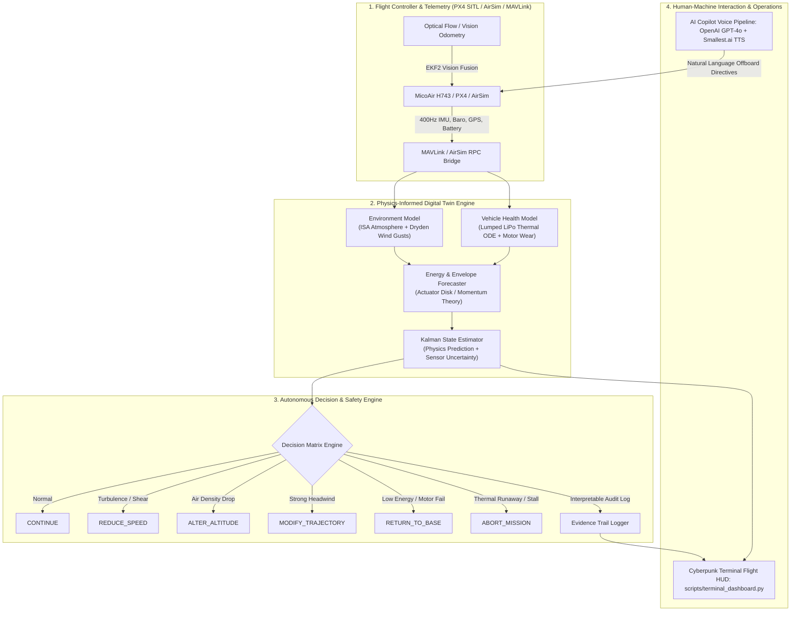

# GarudaOne — Autonomous Drone Operating System & Physics Digital Twin

> **Enterprise-Grade UAV Flight Intelligence & Physics-Informed Digital Twin**  
> Autonomous physical-state estimation, environmental disturbance modeling, proactive health forecasting, and deterministic safety-critical decision systems.

---

## 🔗 Platform Resources & Documentation

* **Live Web Telemetry Dashboard**: [https://garuda-twin.vercel.app](https://garuda-twin.vercel.app) *(Deploying)*
* **Technical Implementation Blueprint**: [Implementation Guide](docs/digital_twin_implementation_guide.md)
* **System Architecture & Specifications**: [System Specifications](docs/hackfusion_gap_analysis.md)
* **Full Documentation Index**: [Documentation Index](docs/DOCUMENTATION_INDEX.md)

---

## 🎯 Executive Summary

**GarudaOne** is an autonomous, physics-grounded decision-support and state-estimation platform designed for unmanned aerial vehicles (UAVs) operating under dynamic, high-stakes real-world conditions.

Unlike conventional drone telemetry monitors that simply display raw sensor readings, GarudaOne executes real-time **first-principles aerodynamic, thermal, and mechanical physics models**. By continually comparing measured states against theoretical constraints through an **Extended Kalman Filter**, the digital twin detects subtle motor degradation, predicts thermal runaway, forecasts exact remaining endurance, dynamically computes safe operating flight envelopes, and autonomously executes life-preserving mission actions (`REDUCE_SPEED`, `ALTER_ALTITUDE`, `MODIFY_TRAJECTORY`, `RETURN_TO_BASE`, `ABORT_MISSION`) with full, human-interpretable evidence chains.

---

## 🏗️ System Architecture



---

## 🧪 Core Feature Matrix

| # | Feature Domain | Physics / Method | Operational Capability | Status |
| --- | --- | --- | --- | --- |
| 1 | **Environmental State Model** | ISA standard atmosphere + Dryden turbulence (MIL-F-8785C) via Ornstein-Uhlenbeck stochastic process | Continuous estimation of atmospheric density, turbulence intensity, and thermal shear | ✅ Production |
| 2 | **Vehicle Health Model** | 1st-order lumped thermal ODE for LiPo heating/cooling + linear motor bearing decay model | Real-time tracking of cell thermal dynamics, payload variations, and individual rotor efficiencies | ✅ Production |
| 3 | **Energy & Endurance Forecaster** | Actuator disk momentum theory: $P_{\text{hover}} = \sqrt{T^3 / (2\rho A)}$ + forward aerodynamic drag profile | Exact power draw forecasting, remaining flight endurance, and reserve energy margins | ✅ Production |
| 4 | **Safe Operating Envelope** | Dynamic constraint boundary solver for thrust-to-weight, max airspeed, and flight ceiling | Real-time compute of mission boundaries based on current airframe and atmospheric state | ✅ Production |
| 5 | **Autonomous Decision Engine** | 6-tier hierarchical failsafe state machine with deterministic priority rules | Proactive trajectory adaptation, speed derating, altitude corrections, RTB, and emergency aborts | ✅ Production |
| 6 | **Interpretable Evidence Trail** | Structured JSON decision telemetry logging triggers, physics deltas, and alternatives | Complete black-box audit trail for every safety-critical decision | ✅ Production |
| 7 | **Uncertainty Quantification** | Scalar & Extended Kalman Filters outputting real-time covariance and confidence bounds | Quantified confidence bands around endurance, battery depletion, and state estimates | ✅ Production |
| 8 | **Terminal Flight HUD** | Full-screen live terminal operations monitor (`rich`) displaying live telemetry, Kalman error bands, and decisions | High-contrast multi-panel flight telemetry and health visualization | ✅ Production |
| 9 | **Automated Scenario Verification** | Comprehensive failure injection harness testing crosswinds, bearing failures, and overheats | Automated end-to-end stress tests ensuring robust recovery under anomalous conditions | ✅ Production |
| 10 | **AI Flight Copilot** | OpenAI GPT-4o spatial reasoning + Smallest.ai neural speech synthesis | Natural language tactical command execution with voice telemetry response | ✅ Production |
| 11 | **GPS-Denied Resilience** | EKF2 vision and optical-flow pose injection for indoor, subterranean, and urban canyon flight | Sub-meter positioning without satellite dependency | ✅ Production |

---

## 📐 Physics Models & Mathematical Foundations

### 1. Environmental State Model (`garuda/digital_twin/environment.py`)

#### A. International Standard Atmosphere (ISA)

Air density $\rho(h)$ and ambient temperature $T(h)$ vary directly with altitude $h$ above sea level:

```text
T(h) = T₀ - L · h
ρ(h) = ρ₀ · (T(h) / T₀)^((g / (R · L)) - 1)

Constants:
  T₀ = 288.15 K (15°C sea level baseline)
  ρ₀ = 1.225 kg/m³
  L  = 0.0065 K/m (Troposphere temperature lapse rate)
  g  = 9.80665 m/s²
  R  = 287.05 J/(kg·K)
```

*Significance*: At elevated altitudes or high temperatures, air density drops significantly. Because rotor thrust scales directly with air density, the aircraft requires higher rotor RPM and draws substantially more power to maintain hover, impacting range and thermal limits.

#### B. Dryden Wind Turbulence Model (MIL-F-8785C)

Real-world atmospheric disturbance consists of a steady wind vector plus frequency-shaped stochastic gusts implemented via discrete Ornstein-Uhlenbeck processes:

```text
v_gust(t + dt) = v_gust(t) · e^(-dt / τ) + σ · √(1 - e^(-2dt / τ)) · N(0, 1)

Parameters:
  τ = gust correlation time constant (~5.0 s)
  σ = turbulence intensity (scales with altitude and ground roughness)
  N(0, 1) = standard normal distribution
```

---

### 2. Vehicle Health & Thermal Model (`garuda/digital_twin/vehicle_health.py`)

#### A. Battery Lumped Thermal Dynamics

Battery core temperature rises due to internal Joule heating ($I^2 R_{\text{int}}$) and dissipates heat through forced convective airflow:

```text
dT_bat / dt = (Q_gen - Q_cool) / (m_bat · C_p)

Where:
  Q_gen  = I² · R_internal
  Q_cool = h_conv(v_air) · A_surface · (T_bat - T_ambient)
  h_conv = 10.0 + 2.0 · v_air  (convective heat transfer coefficient)
  C_p    = 1000.0 J/(kg·K) (specific heat capacity of LiPo cells)
```

#### B. Motor & Rotor Degradation

Each propulsion unit monitors cumulative mechanical wear and bearing friction independently:

```text
η_rotor(t) = η_base · (1.0 - degradation_factor)
T_actual = T_ideal · η_rotor · (ρ(h) / ρ₀)
```

---

### 3. Energy & Endurance Forecasting (`garuda/digital_twin/energy_model.py`)

Utilizing **Actuator Disk Momentum Theory**, induced hover power is derived from total all-up weight $W = m_{\text{total}} \cdot g$ and total rotor disk area $A$:

```text
P_hover = k_induced · √((m · g)³ / (2 · ρ(h) · A_total)) / η_avg
P_forward(v) = P_hover · max(0.6, 1.0 - 0.03 · v) + 0.5 · ρ(h) · C_d · A_front · v³
t_remaining = (SoC · Capacity_effective · V_nominal · 3600) / P_electrical
```

---

## 🧠 Autonomous Decision Engine (`garuda/digital_twin/decision_engine.py`)

The Digital Twin evaluates aircraft health and environmental states at 20Hz against a deterministic, prioritized safety constraint matrix:

```text
┌─────────────────┬──────────────────────────────────────────┬────────────────────────┐
│ Priority        │ Condition Trigger                        │ Autonomous Action      │
├─────────────────┼──────────────────────────────────────────┼────────────────────────┤
│ 1 (Emergency)   │ T_bat > 60°C OR min(η_rotor) < 0.30      │ ABORT_MISSION          │
│ 2 (Critical)    │ Endurance < RTB_reserve OR T_bat > 50°C  │ RETURN_TO_BASE         │
│ 3 (Safety)      │ Air density < 0.95 kg/m³ at high alt     │ ALTER_ALTITUDE         │
│ 4 (Precaution)  │ Turbulence > 0.60 OR high crosswind      │ REDUCE_SPEED           │
│ 5 (Efficiency)  │ Headwind > 50% cruise airspeed           │ MODIFY_TRAJECTORY      │
│ 6 (Nominal)     │ All state variables within envelope      │ CONTINUE               │
└─────────────────┴──────────────────────────────────────────┴────────────────────────┘
```

### Interpretable Decision Evidence Format

Every action generates an inspectable evidence object explaining **what** triggered the action, **why** physics demanded it, and **which** fallback actions were considered:

```json
{
  "timestamp": 1774578120.45,
  "decision": "RETURN_TO_BASE",
  "confidence": 0.94,
  "triggers": [
    {
      "parameter": "battery_temp_C",
      "value": 52.4,
      "threshold": 50.0,
      "severity": "WARNING"
    },
    {
      "parameter": "remaining_endurance_s",
      "value": 182.0,
      "threshold": 210.0,
      "severity": "CRITICAL"
    }
  ],
  "reason": "Battery thermal threshold exceeded with insufficient reserve for full mission profile",
  "physics_snapshot": {
    "hover_power_w": 36.8,
    "air_density_kg_m3": 1.09,
    "wind_speed_ms": 7.4,
    "rotor_efficiencies": [0.90, 0.89, 0.62, 0.90]
  }
}
```

---

## ⚡ Automated Failure Injection & Test Suite (`scripts/scenarios.py`)

Flight operators and engineers can inject anomaly scenarios dynamically or evaluate them via the automated verification harness:

| Scenario | Injected Anomaly | Physics Consequence | Decision Sequence |
| --- | --- | --- | --- |
| **1. Sudden Crosswind** | 12 m/s East crosswind gust injected at $t=30$s | Increased frame drag and lateral drift | `CONTINUE` ➔ `REDUCE_SPEED` ➔ `MODIFY_TRAJECTORY` |
| **2. Motor Bearing Failure** | Motor #3 efficiency drops from 90% to 60% | Asymmetric thrust, increased motor load | `CONTINUE` ➔ `REDUCE_SPEED` ➔ `RETURN_TO_BASE` |
| **3. Battery Thermal Runaway** | Core cell temperature climbs past 55°C | Internal resistance increases, thermal hazard | `CONTINUE` ➔ `RETURN_TO_BASE` ➔ `ABORT_MISSION` |
| **4. In-Flight Payload Release** | Payload mass instantly reduces by 50g | CG shift, hover power requirements drop | `RECALCULATE_ENVELOPE` ➔ `CONTINUE` |
| **5. Multi-Variable Stress** | High altitude + low temp + turbulent wind | Thin air reduces lift; cold degrades LiPo capacity | `ALTER_ALTITUDE` ➔ `REDUCE_SPEED` ➔ `RETURN_TO_BASE` |

---

## 🖥️ Real-Time Operations Terminal HUD

The system provides a real-time terminal operations dashboard built with `rich` (`python scripts/terminal_dashboard.py`). Metrics update live from the first-principles physics pipeline:

```text
┌────────────────────────────────────────────────────────────────────────┐
│                        GARUDAONE DIGITAL TWIN                          │
│               Physics-Informed Real-Time Flight Monitor                │
├────────────────────┬────────────────────┬──────────────────────────────┤
│ 1. TELEMETRY       │ 2. ENVIRONMENT     │ 3. VEHICLE HEALTH            │
│ Altitude: 42.5m    │ Wind: 6.8 m/s (NE) │ Battery: 74% (36.5°C)        │
│ Airspeed: 5.2 m/s  │ Turbulence: 0.38   │ Motor 1: 91% [█████████░]    │
│ GPS Fix: 3D Fix    │ Air ρ: 1.09 kg/m³  │ Motor 2: 90% [█████████░]    │
│ Heading: 045°      │ Temp: 27.2°C       │ Motor 3: 61% [██████░░░░] ⚠  │
│ Pitch/Roll: 2° / 1°│ Shear: 0.12 s⁻¹    │ Motor 4: 90% [█████████░]    │
├────────────────────┼────────────────────┼──────────────────────────────┤
│ 4. ENERGY & POWER  │ 5. FLIGHT ENVELOPE │ 6. UNCERTAINTY BANDS         │
│ Power Draw: 33.4 W │ Max Ceiling: 140 m │ State Covariance: ±0.42 m    │
│ Endurance: 13m 42s │ Max Speed: 9.2 m/s │ Endurance Var: ±1.8 min      │
│ RTB Reserve: 4m 10s│ Max Range: 920 m   │ Sensor/Model Weight: 65 / 35 │
├────────────────────┴────────────────────┴──────────────────────────────┤
│ 7. DECISION TIMELINE & EVIDENCE AUDIT                                  │
│ [00:14:22] CONTINUE          All parameters within nominal bounds      │
│ [00:14:48] REDUCE_SPEED      Turbulence intensity exceeded 0.60        │
│ [00:15:10] RETURN_TO_BASE    Motor #3 efficiency degraded below 0.65   │
└────────────────────────────────────────────────────────────────────────┘
 [HOTKEYS]: [C] Crosswind | [M] Motor Fail | [T] Thermal Runaway | [P] Payload Drop | [R] Reset
```

---

## 🚀 Deployment & Operations Guide

### 1. Software You Need

Everything below is verified on **Windows 11 + PowerShell**. `make` is **not**
used — the `Makefile` is documentation; run the commands directly.

| # | Software | Version | Why | Get it |
|---|---|---|---|---|
| 1 | **Windows** | 11 (64-bit) | Host OS. PowerShell, not `cmd`. | preinstalled |
| 2 | **Python** | 3.10–3.11 | Runtime. 3.11 is what `pyproject.toml` targets. | <https://www.python.org/downloads/> |
| 3 | **Project AirSim** (IAMAI) | **v1.0.1** | The simulator. UE 5.x CityEnviron. | see §1a |
| 4 | **Simulator client** | `projectairsim==1.0.2` | Python API: arm, takeoff, velocity, cameras | `pip install projectairsim==1.0.2` |
| 5 | **OpenCV** | 5.x | Image decode, depth colouring, overlays | `pip install opencv-python` |
| 5b | **Ultralytics** | any | YOLO weights (`yolov8n.pt`) | `pip install ultralytics` |
| 6 | **NumPy** | 1.26+ | Array maths throughout | `pip install numpy` |
| 7 | **7-Zip** | any | Joins the two-part simulator zip | <https://7-zip.org/> |

**Not required, and not used:**

- **Unreal Engine 5.7.4** — the environment ships prebuilt. Only needed if you
  build the plugin from source. No VS2022 on this host, so the
  `build.cmd simlibs_debug` route is unavailable.
- **PX4 SITL / Gazebo / WSL2** — that is `run_city.bat`, a *different* stack.
  Do not run both simulators at once; they fight over MAVLink ports.
- **An API key** — the offline command parser and Windows SAPI TTS both work
  without one. Voice *input* is blocked at the account level regardless.

**Disk and RAM.** The simulator is ~3.2 GB compressed, ~7 GB extracted, and
needs **~1.6–2.4 GB RAM while running**. Run exactly one instance: see the
warning in §1a.

**GPU.** Detection runs on CPU with `yolov8n.pt` at roughly 100–140 ms/frame
(~8 Hz). That is slower than the 20–30 Hz the control loop would like, but it
is enough for a demo. A CUDA PyTorch install is the single biggest win if you
have a GPU.

### 2. Installation & Environment Setup

```powershell
# Clone repository
git clone https://github.com/sameerreddy789/Garuda_OS.git
cd Garuda_OS

# Initialize virtual environment
python -m venv venv
venv\Scripts\activate

# Install dependencies
pip install -r requirements.txt

# Simulator client + perception (see §1 for the full list)
pip install projectairsim==1.0.2 ultralytics opencv-python numpy
```

<a name="sim-env"></a>
### 1a. Simulation Environment — Project AirSim (IAMAI)

**Use the IAMAI Project AirSim build, not the legacy Microsoft AirSim `CityEnviron`.**

The legacy build is Unreal **4.27** and its RPC surface is crippled: it exposes
**no `takeoff`, no `land`, and no `moveBy*` family at all**, and its
`simSpawnObject` **terminates the simulator process**. Verified in isolation —
`/Engine/BasicShapes/Sphere` crashes it, so it is not an asset-path problem.

The IAMAI fork provides the same city rebuilt for Unreal 5.x with a complete API.

| | Legacy AirSim | **Project AirSim (IAMAI)** |
|---|---|---|
| Engine | UE 4.27.2 | UE 5.x (you have 5.7.4) |
| Transport | msgpack-rpc, port **41451** | NNG, ports **8989** topics / **8990** services |
| `takeoff` / `land` / `hover` | not present | ✅ |
| `moveByVelocityBodyFrame` equivalent | not present | ✅ `move_by_velocity_body_frame_async` |
| Yaw rate | hangs (arms a nonexistent API) | ✅ `rotate_by_yaw_rate_async` |
| `spawn_object` | **crashes the sim** | returns `None` for unpackaged assets |

**Download (Windows), two parts, ~3.2 GB:**

```
https://github.com/iamaisim/ProjectAirSim/releases/download/v1.0.1/CityEnviron-Windows-1.0.1.zip.001
https://github.com/iamaisim/ProjectAirSim/releases/download/v1.0.1/CityEnviron-Windows-1.0.1.zip.002
```

Also in v1.0.1: `Blocks`, `Neighborhood`, `LandscapeMountains` (Windows + Linux).

Verify the download before extracting:

```powershell
Get-FileHash .\CityEnviron-Windows-1.0.1.zip.001 -Algorithm SHA256
# f45defee160ec2d05245ed45051c43abee8651ffede59b2f8c6cc978cfa513ba
Get-FileHash .\CityEnviron-Windows-1.0.1.zip.002 -Algorithm SHA256
# 20bcffcd41c3327ff36cac83af12353fcffda66de00e636202c83570a543b4d5
```

Extract with 7-Zip, which joins the two parts automatically:

```powershell
& "C:\Program Files\7-Zip\7z.exe" x CityEnviron-Windows-1.0.1.zip.001 -oD:\ProjectAirSim -y
```

**Use v1.0.1, not v1.1.0.** v1.1.0 is a pre-release whose environment packages are
"pending verification and attachment" — it ships no Windows zips. v1.0.1's client
is `projectairsim==1.0.2`, which is what this repository expects.

**Notes**

- The environment starts with an **empty scene**. The client loads the scene and
  spawns the vehicle; that is normal, not a failure.
- The scene config is a local JSONC file read from `sim_config/`. A starter set
  ships in this repo at `sim_config/` (from the upstream
  `client/python/example_user_scripts/`), including `scene_basic_drone.jsonc`
  which defines a robot named **`Drone1`**.
- **Run only one instance.** The launcher is `CityEnviron.exe` but the actual
  Unreal process is `CityEnviron-Win64-Shipping.exe`, which needs ~1.6 GB. A
  second instance cannot allocate, silently sits as a 7 MB stub, and takes the
  first one's ports. Check with
  `Get-Process *CityEnviron*` before launching.

#### Scene config essentials

`sim_config/scene_basic_drone.jsonc` names the vehicle; the name must match the
`Drone` constructor exactly or the client raises
`Actor <name> not found in the config`.

```python
client = ProjectAirSimClient(port_topics=8989, port_services=8990)
client.connect()
world = World(client, "scene_basic_drone.jsonc", delay_after_load_sec=3)
drone = Drone(client, world, "Drone1")   # name must match the scene config
```

Drive it with coroutines; every command is `await (await drone.method_async(...))`:

```python
drone.enable_api_control(); drone.arm()
await (await drone.takeoff_async())
await (await drone.move_by_velocity_async(v_north=0, v_east=0, v_down=-1.5, duration=3))
await (await drone.move_by_velocity_body_frame_async(
        v_forward=2.5, v_right=0.0, v_down=0.0, duration=2.5, yaw_is_rate=True))
await (await drone.rotate_by_yaw_rate_async(yaw_rate=25.0, duration=2.0))
await (await drone.land_async())
```

**Cameras are pub/sub, not polling.** Call `ImageDisplay.start()` before
subscribing — the stock scene uses a *steppable* clock, and the display object
pumps it. Without it, subscriptions are accepted and no frames ever publish.

```python
from projectairsim.image_utils import ImageDisplay, unpack_image

disp = ImageDisplay()
disp.add_chase_cam("Chase"); disp.add_image("Belly", 0); disp.add_image("Depth", 2)
disp.start()                                    # required: pumps the sim clock

client.subscribe(drone.sensors["Chase"]["scene_camera"],       lambda _, v: on(v))
client.subscribe(drone.sensors["DownCamera"]["scene_camera"],  lambda _, v: on(v))
client.subscribe(drone.sensors["DownCamera"]["depth_camera"],  lambda _, v: on(v))

img = unpack_image(payload)   # data is raw bytes; encoding 'BGR' or '16FC1'
```

Decode with the library's own `unpack_image`. The payload's `data` field is raw
`bytes` (`np.asarray` on it yields a 0-d string, which is the usual symptom of
skipping this). `16FC1` is float16 **metres**, and rows are already bottom-up —
do not `flipud` again.

#### ⚠️ Yaw drops the drone (and the fix)

**In `robot_quadrotor_fastphysics`, any sustained yaw command disengages the
hover controller and the vehicle free-falls at ~1.2 m/s.** This is not a
tuning problem. Measured:

| Command | Altitude change |
|---|---|
| idle body-frame, no yaw | **0.00 m/s** — holds |
| idle body-frame + `yaw_rate=26` | **−1.17 m/s** — free fall |
| after `rotate_to_yaw_async` | **−1.48 m/s** — free fall |

Passing a nonzero yaw rate *inside* `move_by_velocity_body_frame_async` is not
the problem, and issuing a concurrent altitude-holding velocity command does
**not** help. `rotate_to_yaw_async` has the same failure.

**The fix is pulsed yaw.** Short bursts rotate the vehicle and a hover re-issue
restores the altitude controller between them:

| Burst | Heading | Altitude | |
|---|---|---|---|
| 0.15 s × 4 @ 40 dps | **+95.6°** | **−0.02 m** | works |
| 0.30 s × 4 @ 40 dps | +66.1° | −4.00 m | falls |
| 1.00 s × 2 @ 40 dps | −5.0° | −2.93 m | falls |

`ProjectAirSimBackend` does this automatically (`BURST_S = 0.12`,
`DEG_PER_BURST = 20.0`), and `rotate_to_heading()` closes a loop on measured
heading rather than trusting a yaw rate sign — the sign is not the one you
would guess, and guessing it flew the drone 180° away from its target.

**Verified working:** `arm`, `takeoff`, climb, body-frame velocity, **pulsed
yaw**, `hover`, `land`, live scene + depth frames, and metric depth. A full
45 s follow run held **2.8 m altitude for the entire run** with zero
fall-to-ground events.

#### Watching the drone from above

The stock simulator window is a side/chase view, which makes framing impossible
to judge. `scripts/make_follow_config.py` generates a scene that adds an
`EagleCamera` mounted 9 m above the vehicle and pitched straight down, then:

```python
b.cycle_view(3)     # walks the main window to the overhead camera
```

`World.switch_streaming_view()` advances the window to the next camera with
`streaming-enabled: true`. The client cannot report which camera is active, so
confirm it visually.

#### Person-following: the subject is generated

The stock scene has **no people**, and `spawn_object` serves only assets the
environment was packaged with — `/Engine/BasicShapes/Cube` returns `None`.
`spawn_object_from_file` is the escape hatch: it takes raw **bytes**, so the
asset need not exist on the server, and accepts `file_format="gltf"` only.

`garuda/flight/humanoid_glb.py` generates a 1.895 m humanoid glTF 2.0 from
scratch with **no dependencies** — a box per body part in correct proportions.
This machine has `AnimatedCharacter.fbx` and `Mikkt_SkeletalMesh.fbx` in the
UE 5.7.4 engine content, but there is no FBX→glTF converter installed (no
`trimesh`, no Blender, no assimp), so building the glTF directly was cheaper
than adding a toolchain.

```python
from garuda.flight.humanoid_glb import humanoid_bytes

actor = b.spawn_glb("Walker1", humanoid_bytes(), (-1.0, 15.0, 0.0))
b.move_actor_along(actor, [(-8.0, 15.0), (6.0, 15.0)], speed_mps=0.9)
```

YOLO recognises it: **conf 0.33–0.81** in live frames at 7–12 m, which clears
the working threshold (0.15–0.25, not the 0.35 default).

**Status, honestly.** Flight, cameras, depth, subject generation and identity
lock all work. A low lock *ratio* still occurs because the naive servo loses a
walking subject and then searches: it rotates in place at ~20°/tick, which can
sweep past the subject between detections. Control-law quality is covered
offline by `tests/test_cinematic_follow.py`; what is not yet solved is
re-acquisition strategy.

#### Repository backend

`garuda/flight/pas_client.py` implements the same `FlightBackend` Protocol as
`AirSimClient`, so `FollowController`, `SubjectLock`, `ObstacleAvoider` and the
shot planner are transport-agnostic.

```python
from garuda.flight.pas_client import ProjectAirSimBackend
b = ProjectAirSimBackend(); b.connect()
b.takeoff(altitude_m=4.0)
frame = b.get_forward_camera()
b.move_velocity_body(vx=1.0, vy=0.0, vz=0.0, yaw_rate_dps=20.0)
```

```bash
# Full capability check against a running environment
venv\Scripts\python.exe scripts\pas_backend_check.py

# Generate the follow scene: FrontCamera (scene + depth) and EagleCamera
venv\Scripts\python.exe scripts\make_follow_config.py

# Person-following demo (needs the simulator running)
venv\Scripts\python.exe scripts\pas_follow.py --duration 45 --eagle-views 3
```


### 2. Execute Digital Twin & Flight HUD

```bash
# Launch live Terminal Flight HUD (10Hz telemetry monitor)
python scripts/terminal_dashboard.py

# Replay specific physical disturbance scenarios
python scripts/terminal_dashboard.py --scenario crosswind
python scripts/terminal_dashboard.py --scenario motor
python scripts/terminal_dashboard.py --scenario thermal

# Run automated batch verification suite
python scripts/scenarios.py --scenario all --fast
```

### 3. Simulation Environments

#### Unreal Engine 5 + AirSim (Photorealistic City Simulation)

```bash
# Connect GarudaOS to live Unreal Engine 5 AirSim instance
python scripts/run_unreal_pilot.py
# Or launch directly with one-click launcher
run_unreal.bat
```

#### PX4 SITL Simulation

```bash
# Launch PX4 SITL in WSL2
wsl bash scripts/launch_sitl.sh

# Connect MAVLink bridge
make run-sitl
```

### 4. Edge AI Copilot (Natural Language Voice Guidance)

```bash
# Add API credentials to .env
echo "OPENAI_API_KEY=your_key" >> .env
echo "SMALLEST_API_KEY=your_key" >> .env

# Launch interactive voice copilot
python scripts/voice_pilot.py
```

---

## 🏢 Platform Standards & Core Systems

* **Hardware Contract**: Formally defined in [`garuda/hardware_contract.py`](garuda/hardware_contract.py) targeting high-reliability flight controllers (MicoAir743-AIO, STM32H7) and edge compute (Raspberry Pi 5, RK3588).
* **Deterministic Flight Arbiter**: Enforces hard software safety limits, attitude clamps, and velocity boundaries ([`garuda/arbiter/safety_limits.py`](garuda/arbiter/safety_limits.py)).
* **Flight Data Recorder (FDR)**: Microsecond-precision structured telemetry logging for post-flight analysis and incident reconstruction ([`garuda/fdr/`](garuda/fdr/)).
* **Fast Tool Router**: Sub-millisecond direct command parser bypassing heavy models for instant safety maneuvers ([`garuda/brain/needle_router.py`](garuda/brain/needle_router.py)).
* **Product Roadmap & Architecture**: Enterprise expansion plans, hardware ladders, and production playbooks documented in [`docs/architecture/`](docs/architecture/) and [`docs/future_phases/`](docs/future_phases/).

---

## 📜 Academic Foundations & Standards

1. **MIL-F-8785C**: Military Specification — *Flying Qualities of Piloted Airplanes* (Dryden Gust Dynamics).
2. **ICAO Doc 7488/3**: *Manual of the ICAO Standard Atmosphere* (Extended to 80 km).
3. **Leishman, J. G.**: *Principles of Helicopter Aerodynamics* (Actuator Disk Momentum Theory).
4. **Plett, G. L.**: *Battery Management Systems: Battery Modeling* (Coulomb Counting & Thermal ODEs).
5. **Kalman, R. E.**: *A New Approach to Linear Filtering and Prediction Problems* (Optimal State Estimation).

---

## 📄 License

GarudaOne is distributed under the Apache 2.0 License. See [LICENSE](LICENSE) for terms.
