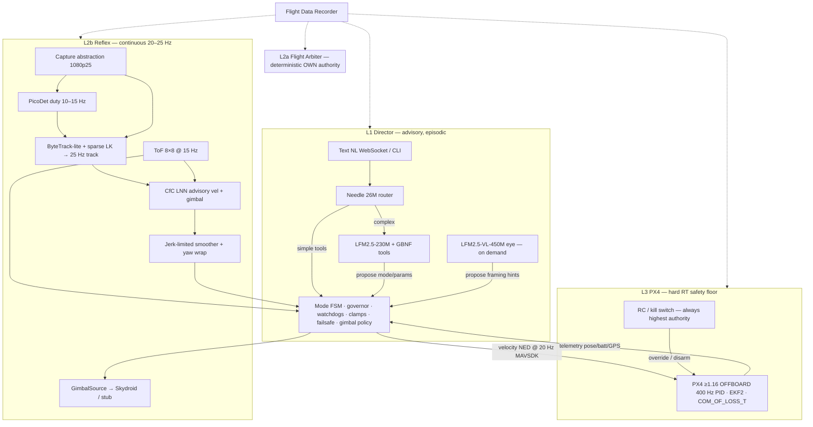
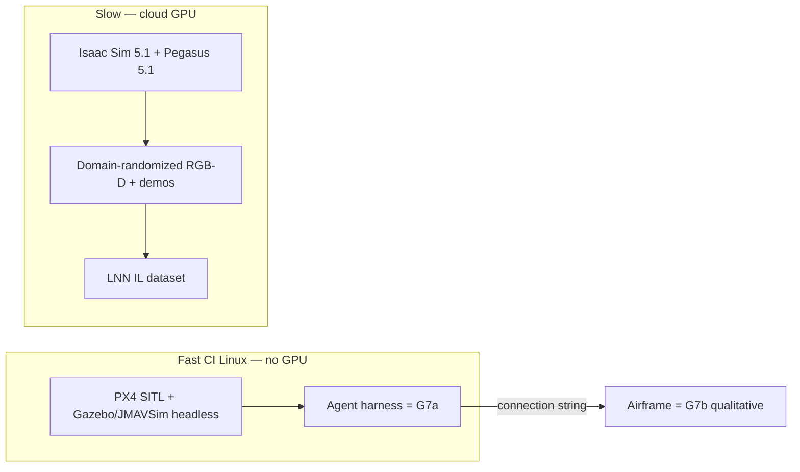

# GarudaOne: Deep Validation + Efficiency/Reliability Optimization + Rebuild Plan (Loop Engineering)

> [!IMPORTANT]
> [DOC_STATUS: HISTORICAL] This dated document preserves research, design, or planning context. It does not describe the current product. Read [GarudaOne current capabilities](../CURRENT_CAPABILITIES.md) first.
>
> Current outcome (2026-08-13):
> - Needle 2 (45M, `cactus-needle==2.0.0`) replaced Needle 26M as the active constrained router.
> - The active PX4 transport is pymavlink, not MAVSDK-Python.
> - The selected flight profile uses one forward VL53L5CX at 8x8/15Hz; three-sensor/VL53L8CX designs are not active.
> - Local voice transport is integrated; the exact STT bundle still requires target-Pi qualification.
> - The integrated runtime supports neutral hover and PX4-confirmed Land/RTL transfer; track remains disabled and autonomous cinematic flight is unavailable.
> - Land/RTL mode transfer requires PX4 ACK and heartbeat confirmation; physical behavior remains unqualified.
> - The integration branch bridges authenticated WebSocket/UI requests to the live runtime arbiter; physical-flight qualification remains blocked.
> - The flight profile instantiates C10 and requires an inbound checksummed status reply; physical attitude feedback and motion limits remain unvalidated.


> [!IMPORTANT]
> This is an architecture/design record, not deployment evidence. Current verified implementation status: [`../docs/IMPLEMENTATION_STATUS.md`](../IMPLEMENTATION_STATUS.md).


> **Repo note (2026-07-15 cleanup):** `garudaone-software/`, `TempPX4/`, `lingbot-vision/`, `lingbot-depth/`, `lingbot-map/`, and `models/lnn_weights.pt` referenced throughout this doc have been removed from this repo (vendored clones + a scrapped v1 codebase's post-mortem docs) — kept only as historical decision record for the audit/rebuild rationale below. Re-clone from upstream before firmware/bench-off work.

| Field | Value |
|---|---|
| **Document** | Design Doc — Rebuild Architecture & Engineering Plan |
| **Author** | Engineering lead: **Arjun** (product/ops gates); Software rebuild: **assign at PR-0** (default owner: repo maintainer until named) |
| **Date** | 2026-07-13 |
| **Revised** | 2026-07-13 (review revision — Issues 1–17) |
| **Status** | Draft (implementable after this revision) |
| **Workspace** | `C:\Projects\droneos` |
| **Source of truth** | `garudaone-architecture/` docs 00–11 |
| **Software state** | `garudaone-software/` code deleted; design MDs only |
| **Dev host OS** | Windows x86_64 OK for unit tests; **SITL CI and flight deploy target Linux (Pi / DietPi Trixie 64-bit)** |

---

## Overview

GarudaOne is an autonomous cinematography drone whose prototype stack is: Raspberry Pi 5 (CPU-only) + MicoAir H743 AIO (PX4 OFFBOARD) + Skydroid 1080p25 gimbal + multi-zone ToF, directed by natural-language **text** commands (voice descoped to product phase). Architecture docs 00–11 describe a 3-layer Liquid AI stack with a deterministic Flight Arbiter owning authority. All Antigravity-generated application code was deleted after audit found unusable LNN weights, unclamped outputs, mock voice firing “follow me” every 10 s, and third-party model provenance failures. Only design MD leftovers remain under `garudaone-software/`.

This document does four things: (1) re-validates architecture claims against primary sources (inherited from docs 08/11) and **local evidence on this Windows machine (2026-07-13)**; (2) incorporates better methods for reliability, efficiency, and performance; (3) proposes an optimized rebuild architecture with **implementable contracts** (FSM table, CfC tensors, arming authority, gimbal path); (4) defines a PR plan with go/no-go gates and loop engineering.

**Bottom line:** Keep the authority-split architecture (L1 Director / L2a Arbiter / L2b Reflex / L3 PX4). Rebuild software from zero with production-grade safety as the default. Do not treat isolated Pi 5 benchmarks as flight budgets. Do not fly the toy 480-param `models/lnn_weights.pt`. Do not download ECE GGUFs. Scope is Phase 1 only (master guide Part 13). **Track demos are blocked** until real LNN weights **and** a working gimbal command path exist.

---

## Background & Motivation

### Current state of the repo

| Path | Reality (2026-07-13) |
|---|---|
| `garudaone-architecture/` | Complete design SSOT (docs 00–11). Read 08, 10, 11 first. |
| `garudaone-software/` | **No Python package.** Only `01_deleted_*.md`–`06_deleted_*.md` + README. |
| `models/lnn_weights.pt` | **TOY:** 11,094 bytes, **480 parameters**, CfC layers shaped **4 / 2 / 4** units — not a 19–50 neuron flight controller. |
| LFM GGUF | **MISSING** (no `*.gguf` in workspace; ECE correctly rejected; official not downloaded). |
| `mavsdk` | **Installed** (import OK on this machine). Pin version in `requirements/` for CI reproducibility. |
| `ultralytics` | **Installed 8.4.84**. Pin for CI; AGPL — flight default remains PicoDet. |
| `llama-cpp-python` / `llama_cpp` | **NOT installed** / not importable. |
| `torch` | 2.12.1+cpu OK. |
| `ncps` | Installable; CfC forward pass works at kHz rates on tiny nets (local bench ~0.33 ms/step). |
| `TempPX4/` | Stale/incomplete clone: **`boards/micoair` missing** despite architecture claim of official `micoair_h743-aio` target (true upstream; local tree lacks it). |
| `lingbot-depth/` | Cloned, Apache-2.0, tech-report present; production NPU path — not Pi CPU. |
| `lingbot-vision/`, `lingbot-map/` | Cloned reference; not prototype control path. |
| `PID-data/` | WhatsApp JPEGs of PID screens only — not machine-readable logs. |
| `garudaone-complete-ai-guide/` | Long-range R&D catalog; **not** build SSOT (Phase 1 only for prototype). |

### Why rebuild (not “fix the old tree”)

Deleted software (documented in `garudaone-software/01–06_deleted_*.md`) exhibited systemic failures:

- Random / toy LNN weights still allowed track mode (audit patched flags, but architecture/versioning never fixed).
- EMA smoother mislabeled as B-spline; no yaw wrap.
- Needle replaced by keyword stub; voice was a mock loop (`"follow me"` every 10 s).
- ECE third-party GGUF default; Modal scripts and downloaders pointed at wrong provenance.
- Architecture mismatch between local (`num_neurons=19`) and cloud train (`num_neurons=10`).
- CfC hidden state (`hx`) never reset between track sessions.
- Docker secrets / hardcoded Antigravity paths.

**Decision already taken:** nuke code, keep design MDs, rebuild correctly with gates.

### Hardware / physics constraints that bind software

From docs 03/10 (must not be forgotten in software design):

- AUW ≈ **292–300 g** → over 249 g nano → **Option A micro-class R&D platform** recommended for prototype (ops confirmation: Q1 / Arjun).
- Endurance ≈ **~5 min usable** on 3S 450 mAh with Pi ~10 W — demo logistics, not product claims.
- Pi 5: pin cores; never ncnn 4 threads in flight; governor **2.0–2.2 GHz**; sustained AI budget **&lt;8 W**.
- OFFBOARD requires continuous setpoints (**≥2 Hz**, we use **20 Hz**); `COM_OF_LOSS_T` + `COM_OBL_RC_ACT` configured for Land (see Authority & arming).

---

## Goals & Non-Goals

### Goals

1. **Validate** architecture claims with explicit verified / EST / FAIL / BLOCKED status and sources.
2. **Rebuild** a correct, testable `garudaone-software/` implementing L1–L3 + Flight Arbiter + **gimbal command path**.
3. **Reliability first:** deterministic authority, clamps, watchdogs, FDR, property-based arbiter tests before any arming.
4. **Efficiency:** duty-cycled detection + flow tracking; official LFM + GBNF; Needle real runtime; core pinning.
5. **Sim CI split:** fast headless PX4 SITL for agent harness; slow Isaac+Pegasus for data gen.
6. **Loop engineering:** measure → one variable → re-gate → log; DAgger for LNN; flight FDR → regression set.
7. Ship a **PR plan** with merge order and go/no-go gates mapped to CI laptop / Pi 5 / airframe.

### Non-Goals (prototype)

- End-to-end VLA on CPU (cannot close 20 Hz).
- Cloud inference on the flight path.
- ROS 2.
- Onboard voice mic / STT / TTS (product phase via BT buds; selections locked in doc 02).
- SVO2 / ARM-VO / VO on gimbal feed.
- Master-guide Phase 2–3: gesture, GarudaPin, 3DGS shot planning, crowd maps, shot memory.
- Production NPU depth (LingBot-Depth) as a prototype control dependency.
- Shipping a nano-class product claim for this airframe.

---

## Claim Validation Matrix

Legend: **✅ Confirmed** · **EST** estimate needing on-target measure · **BENCH-OFF** decide after B-gate · **FAIL** claim vs reality · **BLOCKED** needs hardware · **SOUND** engineering pattern (not a numeric claim)

**Source discipline:** External benchmark numbers in §A are **inherited from architecture docs 08/11** (primary-source pass dated **2026-07-07** in those docs). This rebuild doc revalidated **local** claims on **2026-07-13**; it did not re-fetch every vendor blog. Treat 08/11 as SSOT for external figures until the next scheduled primary-source refresh.

### A. Confirmed against primary sources (via docs 08/11 SSOT)

| Claim | Status | Last primary-source check (SSOT) | Evidence / notes |
|---|---|---|---|
| LFM2.5-230M ≈ 42 tok/s decode on Pi 5 | ✅ | 2026-07-07 (doc 08) | Liquid AI official blog (June 2026); also 213 tok/s Galaxy S25 Ultra. Isolated only. |
| Needle 26M ≈ 1200 tok/s decode, 6000 prefill | ✅ | 2026-07-07 (doc 08) | cactuscompute.com/blog/needle; MIT; HF Cactus-Compute/needle |
| PicoDet-S ≈ 53.7 FPS Pi 5 ncnn @ 320 | ✅ | 2026-07-07 (doc 08) | Qengineering table, RPi 5 @ 2900 MHz — **ISOLATED only**; mAP ~27.0 |
| CfC / `ncps` Apache-2.0, installable | ✅ | 2026-07-13 local | Local: forward pass works; ~0.33 ms/step on tiny net. Control cost is **not** the bottleneck. |
| PX4 OFFBOARD + MAVSDK; continuous setpoints required | ✅ | 2026-07-07 (doc 08) | PX4 docs: `COM_OF_LOSS_T`; stream ≥2 Hz; plan 20 Hz |
| LEVIO exists for embedded VIO | ✅ | 2026-07-07 (doc 11) | arXiv 2602.03294 — optional B2 only |
| LingBot-Depth exists | ✅ | 2026-07-07 + local clone | arXiv 2601.17895, ECCV 2026; **production NPU**, not Pi CPU |
| Flight Arbiter (deterministic authority) | SOUND | 2026-07-07 (doc 11) | AI advisory; deterministic mode FSM owns authority; PX4 safety floor |
| MicoAir743-AIO official PX4 target `micoair_h743-aio` | ✅ upstream | 2026-07-07 (doc 08) | Local `TempPX4/boards/micoair` **MISSING** (stale clone) |
| Isaac Sim + Pegasus + PX4 SITL viable | ✅ | 2026-07-07 (doc 05/08) | Strict version pins (Isaac 5.1 ↔ Pegasus v5.1.0) |
| Sub-250 g nano regulatory class (India) | ✅ | 2026-07-07 (doc 08) | **Does not apply** to this ~292 g prototype |
| DJI import ban India | ✅ | 2026-07-07 (doc 08) | DGFT since Feb 2022 |

### B. Confirmed with caveats / estimates

| Claim | Status | Caveat |
|---|---|---|
| PicoDet 20–30 FPS concurrent flight | EST | Never quote 53.7 as flight budget; **duty-cycle 10–15 + flow @ 25 Hz track** is correct approach |
| LFM concurrent 25–35 tok/s | EST | No public concurrent multi-workload bench — **must measure G3** |
| YOLO26n better than PicoDet | BENCH-OFF | Ultralytics Pi5 class; at 320 + person-only may win p99. **AGPL production risk** |
| Weight ~292–300 g | ✅ physics | Over 249 g; Option A micro-class R&D recommended (doc 10 §1) |
| Endurance ~5 min | EST hover power | Needs scale + power meter (G1/G2) |
| ToF 8×8 @ 15 Hz, 4–5 m | ✅ datasheet | Not 60 Hz at 8×8 (08 C4); **provisional default VL53L8CX** (KD22) |
| Skydroid C10 Pro 1080p25, ~61 g | ✅ | Not 4K prototype demos |
| Speed envelope ≤3 m/s indoor ToF, ≤5 m/s open air | SOUND | Nothing for 8–10 m/s without better range (doc 04/10) |

### C. Local test results (this machine, Windows x86_64, 2026-07-13)

| Test | Result | Implication for rebuild |
|---|---|---|
| `garudaone-software` code | **GONE** — design MD leftovers only | Full greenfield package + tests |
| `models/lnn_weights.pt` | **TOY: 480 params**, layers 4/2/4, 11,094 B | **FAIL for production use** — refuse track until real DAgger/IL weights |
| LFM GGUF | **MISSING** | Download official `LiquidAI/LFM2.5-230M-GGUF` only; hash-pin in G4 |
| `mavsdk` | **Installed** (import OK) | Still **pin** in `requirements/base.txt` for CI; do not rely on ambient env |
| `ultralytics` | **Installed 8.4.84** | Pin for dev/B1; not flight default detector |
| `llama_cpp` | **NOT installed** | PR-0/C2 bootstrap; needed for real G4-T2 |
| torch 2.12.1+cpu | OK | Train/export on laptop; Pi uses ncnn/llama.cpp |
| `ncps` CfC | OK at kHz | Keeps CfC; cost is free vs vision/LFM |
| `TempPX4` micoair board | **MISSING** | Re-clone/update PX4 ≥1.16 before FC flash work |
| `lingbot-depth` | Cloned, not runnable without GPU weights | Keep as P1 reference; no Pi control dep |
| `PID-data` | JPEG screenshots only | Export uLog for real tuning; Betaflight ≠ PX4 1:1 |

### D. Critical gaps (cannot fully test without hardware)

| Gap | Blocked gates | Mitigation until hardware |
|---|---|---|
| No Raspberry Pi 5 | G3 concurrency, PicoDet flight FPS, LFM concurrent tok/s, B1–B4 | SITL + x86 unit/property tests; stub ncnn; pin benches as first Pi work |
| No airframe | G1 weight, G2 endurance, G5 failsafe kill-Pi, G6 ToF glass | Bench FC on desk with power supply; mock ToF; SITL failsafe tests first |
| No real software yet | G4/G7/G8 unit+integration | **Build tests with modules** — arbiter/FDR first, flight last |
| Deleted code intentionally | All flight paths | Rebuild with gates; do not resurrect Antigravity tree |

### E. Architecture doc claim → rebuild disposition

| Doc claim | Disposition |
|---|---|
| 3-layer + Flight Arbiter (01, 11) | **ADOPT** as backbone |
| Gimbal counter-rotation cinematic flow (01, 04) | **ADOPT** — explicit `gimbal/` path + PR-G1 (was gap; fixed this revision) |
| PicoDet-S production fallback Apache | **ADOPT**; YOLO26n optional B1 only |
| Duty-cycle detect + ByteTrack-lite + sparse LK | **ADOPT** (largest thermal ROI) |
| Official LFM + GBNF + KV prefix cache | **ADOPT** |
| Real Needle runtime | **ADOPT** (replace keyword stub) |
| CfC advisory cinematic velocity + gimbal | **ADOPT** after **real** training under **CfC contract v1** |
| Jerk-limited smoother + yaw wrap | **ADOPT** (reject EMA-as-B-spline) |
| EKF2 + multi-zone ToF; no gimbal VO | **ADOPT** |
| Text NL WebSocket P0 | **ADOPT** |
| LingBot-Depth on Pi | **REJECT** |
| E2E VLA / ROS 2 / cloud flight path | **REJECT** |
| Master guide Phase 2+ features | **OUT OF SCOPE** prototype |

---

## Better Methods (ranked by ROI)

Rank order: **reliability → performance/efficiency → nice-to-have**.

### Tier 1 — Reliability (do first; highest ROI)

| # | Method | Why higher ROI | Action |
|---|---|---|---|
| R1 | **Authority split hardened** — L1 advisory only; L2a Arbiter owns modes/limits; L3 PX4 floor | Single biggest reliability win | First non-infra code PR after scaffolding |
| R2 | **Hard clamps + speed governor** via single `SafetyLimits` config | Prevents LNN/LFM unsafe setpoints | Mandatory before any arming path |
| R3 | **Refuse track mode without validated LNN weights** (hash + arch version + load check) | Toy 480-param ckpt must never fly | Startup gate + unit tests |
| R4 | **Watchdogs**: target-lost, thermal, battery, geofence, setpoint age, **gimbal heartbeat** | Old code relied only on PX4 | Implement in arbiter; property-test |
| R5 | **Flight Data Recorder** (all topics + arbiter decisions) | Every flight → regression + DAgger | Ship with first SITL flights |
| R6 | **Property-based / fault-injection tests for arbiter (G8)** | Makes reliability designable | CI required before arming helpers merge |
| R7 | **GBNF grammar-constrained tool calls** | Syntax validity ≈100% for tool JSON | Prefer **single** tool-schema grammar |
| R8 | **Official LiquidAI/LFM2.5-230M only** + G4 hash pin | ECE provenance FAIL | download script + CI hash check |
| R9 | **PX4 OFFBOARD contract** ≥20 Hz stream; failsafe params **with numeric values** | Pi death must Land/RTL | G5; SITL partial + airframe final |
| R10 | **Process pinning / cgroups** (Linux flight host); never ncnn 4 threads; CPU 2.0–2.2 GHz | Thermal throttle is silent reliability failure | systemd units + G3 |
| R11 | **RC-primary arm/takeoff; software OFFBOARD only after stream healthy** | Rebuild safety interface | See Authority & arming |

### Tier 2 — Performance / efficiency

| # | Method | Why | Action |
|---|---|---|---|
| E1 | **Detector duty-cycle 10–15 Hz + ByteTrack-lite + sparse LK @ 25 Hz track** | Largest thermal/CPU win | Default perception path |
| E2 | **Person-only fine-tune 192×320** | ~2× speed potential | **Optional if labeled aerial person data exists** — PR-P2b; not assumed for B1 baseline |
| E3 | **B1: PicoDet-S vs YOLO26n @ 320 INT8 ncnn, 2 cores** | NMS-free p99 may favor YOLO26n; Apache fallback PicoDet | Bench on Pi; production ships PicoDet unless license bought |
| E4 | **Needle for simple commands** — real runtime | Frees LFM CPU | Integrate; **soft-require** until smoke pass (then flight.yaml) |
| E5 | **llama.cpp prefix/KV cache system prompt once** | Prefill amortized | Brain init path |
| E6 | **Prefer PX4 velocity setpoints** (not thrust open-loop) | Leverages EKF2 + rate loops | MAVSDK `set_velocity_ned` only for P0 |
| E7 | **Jerk-limited filter** (not EMA) with yaw wrap | Cinematic without fake claims | Control PR |
| E8 | **Sim CI split**: Gazebo/JMAVSim headless fast; Isaac+Pegasus slow data gen | Agent harness seconds not minutes | CI + cloud GPU separation |
| E9 | **Cap LFM/VLM episodic** — never in 20 Hz loop | Protects control jitter | Arbiter schedules |

### Tier 3 — Optional / later

| # | Method | Verdict |
|---|---|---|
| O1 | Hailo-8 / Pi AI Kit NPU | **OPTIONAL branch** |
| O2 | LEVIO/OpenVINS on **fixed GS nav cam** (B2) | Optional GPS-denied; never gimbal feed |
| O3 | Depth-Anything-V2-small 1 Hz fused with ToF (B3) | Advisory only on CPU |
| O4 | LFM2.5-VL-450M Director’s Eye (B4) | Episodic; 1–3 s/frame EST |
| O5 | Antidoom / FTPO for larger reasoning models | Not needed for 230M tool-call agent |
| O6 | LingBot-Depth dense completion | **PRODUCTION NPU only** |

### Explicitly REJECTED (prototype)

| Item | Reason |
|---|---|
| End-to-end VLA on CPU | Cannot close 20 Hz |
| Cloud inference flight path | Offline product vision; Modal = train/data only |
| ROS 2 | Overkill single-purpose product |
| Onboard voice mic | Acoustic FAIL in flight (08 N4 closed) |
| SVO2 / ARM-VO | License + gimbal-frame flaw |
| Flying toy/random LNN weights | Audit FAIL |
| ECE / third-party LFM GGUF | Provenance FAIL |
| Master guide gesture / GarudaPin / 3DGS / crowd maps | Phase 2+ only |
| Unconstrained software arm from Wi-Fi | Safety — RC-primary arming (KD23) |

---

## Optimized Target Architecture

### Layer model (authority-first)



### Rates & budgets

| Path | Rate | Notes |
|---|---|---|
| Setpoint stream | **20 Hz** | `SET_POSITION_TARGET_LOCAL_NED` velocity; PX4 needs ≥2 Hz |
| Track output | **25 Hz** | Flow-propagated bbox; detector 10–15 Hz |
| ToF grid | **15 Hz** 8×8 (or 4×4 @ 60 Hz fallback) | Primary glass/wall sensor |
| CfC + smoother | **20 Hz** | Inference negligible (&lt;1 ms) |
| Gimbal command | **20 Hz** when track granted | Freeze on link loss (doc 10 §6 #6) |
| Needle | on command | ~50 ms-class |
| LFM | on complex command | &lt;30 tokens → &lt;1 s concurrent EST |
| VLM eye | on demand | 1–3 s/frame EST; never control loop |
| PX4 inner loops | 400 Hz | Unchanged |

### Core pinning (Pi 5, 4× A76) — Linux flight host only

| Core | Workload |
|---|---|
| 0–1 | Perception (ncnn **2 threads max**); detector duty-cycled |
| 2 | Control loop + MAVSDK + CfC + smoother + arbiter tick + gimbal send |
| 3 | LFM/Needle/VLM bursts + text server + FDR writer (shared) |

Rules:

- `taskset` + cgroups on **Linux (Pi)**; Windows dev skips pinning (no-op in `util/pinning.py`).
- Never allow ncnn to autospawn 4 threads in flight.
- CPU governor **2.0–2.2 GHz** for sustained &lt;8 W package.
- Thermal thresholds from `SafetyLimits` (below).

### SafetyLimits — single policy source (`configs/default.yaml`)

All numeric safety thresholds live here. **Only the arbiter applies policy.** `control/clamps.py` mirrors `v_max` / max components **from the same config object** (defense-in-depth, not a second policy).

```yaml
# configs/default.yaml — SafetyLimits (KD13 / doc 10)
safety:
  setpoint_hz: 20
  setpoint_age_warn_ms: 100
  setpoint_age_hold_ms: 250          # companion hold if stream stutters but still < PX4 loss
  com_of_loss_t_s: 0.5               # PX4 COM_OF_LOSS_T — G5 must meet this + 1s
  com_obl_rc_act: 2                  # PX4: Land (confirm enum against PX4 ≥1.16; document actual in PR-L2)
  # COM_OBL_RC_ACT: use Land for prototype (safer than loiter for micro indoor demos)

  v_mode_cap_mps:
    hover: 0.0
    hold: 0.5
    track: 5.0
    land: 1.5
    rtl: 3.0
    search: 1.0

  v_tof:
    # v_tof = 0 if confidence low; else scale by min_range
    min_confidence: 0.4              # per-zone fraction valid
    range_full_mps: 5.0              # sensing range for full indoor budget
    v_at_full_range_mps: 3.0         # indoor ToF envelope
    v_if_blind_mps: 0.5              # ToF unhealthy → crawl or hover-only
    # formula: if conf < min_confidence: v_tof = v_if_blind
    # else: v_tof = v_at_full_range_mps * clamp(min_range_m / range_full_mps, 0.2, 1.0)

  v_semantic_open_air_mps: 5.0
  v_gps_degraded_mps: 2.0            # EKF2 variance high → optical flow hold envelope

  thermal_c:
    warn: 80                         # drop detector duty, defer LFM/VLM
    land: 85

  battery:
    land_v_per_cell_under_load: 3.5  # doc 10 §6 #9
    never_below_v_per_cell: 3.4
    cells: 3                         # 3S prototype

  target_lost:
    hover_s: 2.0                     # no bbox → hover
    search_s: 10.0                   # then slow yaw search mode
    rtl_s: 30.0                      # then RTL

  gimbal:
    heartbeat_timeout_s: 1.0
    on_loss: freeze_and_disable_counter_rotation  # doc 10 §6 #6

  geofence:
    max_horiz_m: 50.0                # demo default; tune per site
    max_alt_m: 30.0

  command_ws:
    rate_limit_hz: 5
    require_token_in_flight_yaml: true
```

**Governor (hard):**

```
v_max = min(
  v_mode_cap[mode],
  v_tof(min_range, zone_confidence),   # formula in yaml comments above
  v_semantic_open_air if open_air_track else +inf,
  v_gps_degraded if ekf_degraded else +inf,
  v_thermal_cap,                       # 0 if thermal_land else mode cap
  v_battery_cap
)
# LNN and LFM cannot override
```

### Authority & arming (safety interface)

**Principle:** Radio (ELRS → PX4) is always highest authority. Companion software is a guest on OFFBOARD.

| Action | Who may request | Who grants | Notes |
|---|---|---|---|
| **Arm** | **Human RC only** (PX4 arm switch / stick gesture) | PX4 arming checks | Software **must not** expose Wi-Fi `arm` tool in flight profile |
| **Takeoff** | Human RC **or** explicit local CLI with `--i-accept-risk` + preflight all-green (lab only) | PX4 + arbiter preflight | **No takeoff from WebSocket** in `flight.yaml` |
| **Enter OFFBOARD** | Companion after preflight | PX4 | Sequence below |
| **Mode hover/track/land/rtl** | Needle/LFM/operator CLI propose; watchdogs force | **Arbiter only** | Wi-Fi may propose land/hover/rtl/track (see KD24) |
| **RC override mid-OFFBOARD** | Pilot sticks / mode switch | PX4 | Arbiter observes telemetry; suspends track proposals; does not fight RC |
| **Kill / disarm** | RC kill / PX4 failsafe | PX4 | Immediate |

**OFFBOARD start sequence (mandatory):**

1. Connect MAVSDK (`connect` timeout 15 s).
2. Wait PX4 health: local position estimate OK (or SITL equivalent).
3. Arbiter preflight checklist all `true` (FDR-logged):
   - `link_ok`, `setpoint_thread_ready`, `safety_limits_loaded`
   - `lnn_status` ∈ {`not_required`, `loaded_allowlisted`} for intended modes
   - `tof_ok` **or** `tof_mock_allowed` (I1a only)
   - `gimbal_ok` **or** `gimbal_not_required` (hover-only)
   - `com_params_verified` (PR-L2 values applied)
4. Start **velocity setpoint stream at 20 Hz** (zeros) for ≥500 ms.
5. `start_offboard()` only while stream healthy (`setpoint_age < setpoint_age_hold_ms`).
6. On stream failure before engage: abort, never arm from software.

**PX4 failsafe params (prototype defaults — PR-L2 locks exact QGC/param file):**

| Param | Value | Meaning |
|---|---|---|
| `COM_OF_LOSS_T` | **0.5 s** | Time after OFFBOARD setpoint loss before failsafe |
| `COM_OBL_RC_ACT` | **Land** (param int per PX4 1.16 docs; confirm in PR-L2) | Action on OFFBOARD loss |
| Companion stream | **20 Hz** | Must be continuous while OFFBOARD |

**Preflight booleans (FDR `preflight.json` before any arm helper exposed in CLI):**

```
preflight.g8_ci_green
preflight.refuse_toy_lnn_test_green
preflight.g4_tier  # "T0" | "T1" | "T2" — arming helpers require ≥ T0; track requires weights allowlist not G4
preflight.com_params_set
preflight.fdr_writable
preflight.enable_track_mode == false  # until DAgger allowlist
```

### Flight Arbiter FSM (authoritative transition table)

**Modes:** `disarmed` | `hover` | `hold` | `track` | `search` | `land` | `rtl`

**Initial mode:** `disarmed` (software). Physical arm is PX4-side; arbiter moves to `hover` only after OFFBOARD engaged and first grant.

**Event sources:** `tool` (Needle/LFM/operator proposal), `wd` (watchdog), `rc` (RC/PX4 telemetry), `sys` (internal).

Named constants from `safety.target_lost.*` and `SafetyLimits` (not magic numbers in code).

| from | event | guards | to | action |
|---|---|---|---|---|
| `disarmed` | `sys.offboard_engaged` | preflight OK; stream healthy | `hover` | zero vel; v_max=hover |
| `disarmed` | `tool.*` | any | `disarmed` | **reject** proposal; log |
| `hover` | `tool.hover` | — | `hover` | ack; zero vel |
| `hover` | `tool.land` | — | `land` | begin land profile |
| `hover` | `tool.rtl` | — | `rtl` | begin RTL setpoints / PX4 RTL action |
| `hover` | `tool.track_subject` | `enable_track_mode`; weights allowlisted; track healthy; gimbal_ok **or** `allow_track_without_gimbal` | `track` | reset CfC `hx`; grant track params |
| `hover` | `tool.track_subject` | weights missing / toy / flag false | `hover` | **refuse**; reason `weights_not_loaded` / `track_disabled` |
| `hover` | `tool.set_framing` | track not active | `hover` | store framing params for next track; optional gimbal preset if link ok |
| `track` | `tool.hover` / `tool.stop` | — | `hover` | reset hx; zero vel |
| `track` | `tool.land` | — | `land` | reset hx |
| `track` | `tool.rtl` | — | `rtl` | reset hx |
| `track` | `tool.set_framing` | — | `track` | update framing kwargs; no mode change |
| `track` | `wd.target_lost` ≥ `hover_s` (2 s) | no valid bbox | `hover` | notify app; reset hx |
| `hover` | `wd.target_was_lost` & timer ≥ `search_s` (10 s) since loss while operator wanted track | last grant was track | `search` | slow yaw search; v_max=search |
| `search` | `wd.bbox_reacquired` | conf ≥ threshold | `track` | reset hx; resume |
| `search` | timer ≥ `rtl_s` (30 s) since original loss | — | `rtl` | RTL |
| `search` | `tool.hover` / `tool.land` / `tool.rtl` | — | as tool | clear search timer |
| `*` (airborne modes) | `wd.thermal ≥ land` (85 °C) | — | `land` | force land |
| `*` airborne | `wd.thermal ≥ warn` (80 °C) | — | same mode | drop detect duty; defer LFM/VLM; log |
| `*` airborne | `wd.battery ≤ land_v` | under load | `land` | force land |
| `*` airborne | `wd.geofence_breach` | — | `rtl` | or land if RTL unsafe — config |
| `*` OFFBOARD | `wd.setpoint_age ≥ hold_ms` | still &lt; COM loss | `hold` | zero/slow hold until stream recovers |
| `hold` | `wd.setpoint_age` healthy | — | previous mode or `hover` | resume policy: always `hover` if previous was track |
| `*` | `wd.gimbal_heartbeat_lost` | was track | `track` or `hover` | **freeze gimbal**; set `counter_rotation_enabled=false`; optional force hover if config `require_gimbal_for_track` |
| `*` | `sys.wifi_command_link_lost` | — | **no change** | hold last grant; non-flight-critical |
| `*` | `rc.override_active` | PX4 reports RC override / not OFFBOARD | `hover` (logical) | stop proposing track; stream zeros if still OFFBOARD else idle |
| `*` | `rc.disarm` / PX4 disarmed | — | `disarmed` | stop setpoints gracefully |
| `land` | `sys.landed` | PX4 landed | `disarmed` | stop OFFBOARD |
| `rtl` | `sys.landed` / home | — | `disarmed` | stop OFFBOARD |
| `land` / `rtl` | `tool.track_subject` | — | same | **reject** |

**PR-A1 acceptance criteria:** unit tests encode every row above (table-driven); illegal transitions assert reject; no ML in module.

### Critical interfaces

```python
# Tool proposal (L1 → L2a) — GBNF-constrained; NO arm/takeoff in flight schema
class ToolProposal(TypedDict):
    schema_version: Literal["v1"]
    tool: Literal["hover", "land", "rtl", "track_subject", "set_framing"]
    kwargs: dict  # distance_m, framing, yaw_rate_max, ...
    source: Literal["needle", "lfm", "vlm", "operator"]
    confidence: float

# Arbiter grant (only path that mutates mode)
class ModeGrant(TypedDict):
    mode: Literal["disarmed", "hover", "hold", "track", "search", "land", "rtl"]
    v_max: float
    counter_rotation_enabled: bool
    reason: str
    ts: float

# Reflex output (L2b → L2a clamp) — NED velocities (KD21)
class VelocityCmd:
    vx: float  # NED North m/s
    vy: float  # NED East m/s
    vz: float  # NED Down m/s (PX4 NED)
    yaw_rate: float  # rad/s, body yaw rate or NED yaw rate — use **body yaw rate** for PX4 yawspeed
    source: Literal["cfc", "hover_hold", "search", "failsafe"]

# Gimbal command (L2a policy → GimbalSource)
class GimbalCmd:
    yaw_deg: float    # relative to body or absolute per backend contract
    pitch_deg: float
    rate_limit_dps: float
    freeze: bool      # true on link loss / watchdog
    source: Literal["cfc", "framing", "freeze", "preset"]
```

### CfC / LNN contract v1 (frozen — KD21 / KD9)

**Architecture ID:** `cfc_v1_n19_i12_o5`

| Item | Value |
|---|---|
| Library | `ncps` CfC + `AutoNCP` |
| `num_neurons` (P0 default) | **19** |
| `input_size` | **12** |
| `output_size` | **5** |
| Output meaning | `[vx_ned, vy_ned, vz_ned, yaw_rate_body, gimbal_yaw_deg]` |
| Hidden state `hx` | Reset to zeros on: enter `track`, exit `track`, target-id change, refuse-track |
| Frame for **setpoints** | **NED velocity** to PX4 via MAVSDK |
| Frame for **bbox features** | **Image-normalized body-relative** (see vector) — camera is gimbal-stabilized; bbox is framing error in image plane, not world |

**Input feature vector v1** (`float32[12]`, ordered):

| Idx | Name | Units / range | Notes |
|---|---|---|---|
| 0 | `cx` | [0,1] | bbox center x / image width |
| 1 | `cy` | [0,1] | bbox center y / image height |
| 2 | `bw` | [0,1] | bbox width / image width |
| 3 | `bh` | [0,1] | bbox height / image height |
| 4 | `tof_min_m` | meters | min range in forward cone (clip 0–10) |
| 5 | `tof_left_m` | meters | left zone aggregate |
| 6 | `tof_center_m` | meters | center |
| 7 | `tof_right_m` | meters | right |
| 8 | `tof_conf` | [0,1] | mean zone confidence |
| 9 | `vx_cur` | m/s | current NED vx from EKF2 |
| 10 | `vy_cur` | m/s | current NED vy |
| 11 | `tool_dist_norm` | [0,1] | desired subject distance / 10 m (from track grant kwargs) |

**Output vector v1** (`float32[5]`):

| Idx | Name | Clamp before arbiter |
|---|---|---|
| 0–2 | `vx, vy, vz` NED | ±`v_max` components; vz ±`min(v_max, 1.5)` |
| 3 | `yaw_rate` | ±1.0 rad/s default |
| 4 | `gimbal_yaw_deg` | ±45° |

**Checkpoint meta schema** (embedded in `.pt` or sidecar `.meta.json`):

```json
{
  "arch_id": "cfc_v1_n19_i12_o5",
  "input_size": 12,
  "output_size": 5,
  "num_neurons": 19,
  "status": "flight" | "smoke" | "toy",
  "git_sha": "...",
  "dataset_id": "...",
  "created_utc": "...",
  "sha256": "..."
}
```

**Allowlist rule:** Track grant requires `status=="flight"`, `arch_id` match, sha256 in `configs/models.yaml` allowlist.  
**Toy file** `models/lnn_weights.pt` (480 params, 4/2/4): must load as `status:toy` / arch mismatch → `weights_loaded=False`.  
**Smoke weights:** may use same arch with `status:smoke` for CI only — never in `flight.yaml` allowlist.

### Capture abstraction (sim-to-real)

```
CameraSource protocol:
  frames() -> Iterator[Frame]  # bgr/rgb, timestamp, size
  heartbeat_ok() -> bool
Implementations:
  - FileSource / WebcamSource (dev + CI)
  - SkydroidSource (reverse-engineered link, Pi) — PR-P1b
  - SiyiSource (optional backup SDK)
  - IsaacSimSource (cloud / workstation)
  - FixedPiCamSource (autonomy fallback if gimbal feed dies)
```

### Gimbal abstraction

```
GimbalSource protocol:
  send(GimbalCmd) -> None
  heartbeat_ok() -> bool
  get_joint_angles() -> Optional[GimbalState]  # if protocol exposes
Implementations:
  - NullGimbal / LogGimbal (CI, hover-only)
  - SkydroidGimbal (prototype)
  - SiyiGimbal (backup)
```

**Fail modes (doc 10 §6 #6):** heartbeat timeout → `freeze=true`, `counter_rotation_enabled=false`, continue flight; if `require_gimbal_for_track` → transition toward hover.

### Connection strings (G7a)

| Environment | Address |
|---|---|
| PX4 SITL (CI Linux) | `udp://:14540` (project standard) |
| Pi → FC UART | `serial:///dev/ttyAMA0:921600` (`dtparam=uart0=on`) |

---

## Software Rebuild Blueprint

### Package layout

Greenfield under `C:\Projects\droneos\garudaone-software\` (archive deleted-design MDs into `docs/legacy_deleted/`).

```
garudaone-software/
  README.md
  pyproject.toml
  requirements/
    base.txt                     # mavsdk (pin), numpy, scipy, pydantic, pyyaml
    perception.txt               # opencv, ncnn bindings; ultralytics pin (dev/B1 only)
    cognition.txt                # llama-cpp-python, needle runtime deps
    control.txt                  # torch (train), ncps
    dev.txt                      # pytest, hypothesis, ruff, mypy
  configs/
    default.yaml                 # SafetyLimits + rates + FSM timers
    sitl.yaml
    flight.yaml                  # require_token, enable_track_mode: false
    models.yaml                  # hashes, arch_id allowlist, official URLs only
  src/garudaone/
    __init__.py
    main.py
    arbiter/
      fsm.py                     # table-driven transitions (authoritative table above)
      governor.py                # reads SafetyLimits only
      watchdogs.py
      clamps.py                  # mirrors SafetyLimits, not second policy
      arbiter.py
      safety_limits.py           # pydantic SafetyLimits
    perception/
      camera.py
      detector.py
      tracker.py
      worker.py
      tof.py
    gimbal/
      protocol.py                # GimbalSource, GimbalCmd
      null_gimbal.py
      skydroid.py                # reverse-eng backend
      siyi.py                    # optional backup
    control/
      cfc_controller.py          # cfc_v1_n19_i12_o5; hx reset policy
      smoother.py
      clamps.py                  # mirror config maxes
      train_il.py
      train_dagger.py
    cognition/
      needle_router.py
      lfm_brain.py
      grammars/flight_tools.gbnf
      tools_schema.py
      vlm_eye.py
      text_server.py
    link/
      drone_link.py
      px4_params.md              # numeric COM_* values + G5 procedure
      arming.py                  # preflight gates; no Wi-Fi arm
    fdr/
      recorder.py                # default: jsonl (KD25)
      topics.py
    util/
      pinning.py                 # Linux taskset; Windows no-op
      logging.py
      config.py
  scripts/
    download_models.py
    export_picodet_ncnn.py
    run_sitl_hover.py
    run_agent_harness.py
    bench_detector_b1.py
    bench_g3_soak.py
  tests/
    unit/
      test_arbiter_fsm.py         # table-driven all FSM rows
      test_governor.py
      test_clamps.py
      test_smoother_yaw.py
      test_cfc_refuse_without_weights.py
      test_cfc_hx_reset.py
      test_gbnf_tools.py
      test_queue_drain.py
      test_gimbal_freeze.py
    property/
      test_arbiter_fault_injection.py
    integration/
      test_sitl_offboard_stream.py
      test_command_to_mode.py
    fixtures/
      commands_100.json
      toy_lnn_should_fail.pt
  docs/
    legacy_deleted/
```

### Module contracts (critical)

| Module | Must | Must not |
|---|---|---|
| `arbiter` | Own mode; apply SafetyLimits; failsafe; pure deterministic; FSM table | Import torch/llama; trust LFM blindly |
| `perception` | Fresh bbox only; health heartbeat | Block control loop |
| `gimbal` | Heartbeat; freeze on loss; rate-limit cmds | Run VO on gimbal frames |
| `cfc_controller` | arch_id match; `weights_loaded`; NaN→0; **hx reset** | Enter track without validated weights; load toy as flight |
| `smoother` | Jerk limit; yaw wrap ±π | Claim B-spline until implemented |
| `needle_router` / `lfm_brain` | Propose tools only | Mutate mode; arm; call MAVSDK |
| `drone_link` / `arming` | 20 Hz setpoints **before** OFFBOARD; connect timeout; RC-primary arm | Software arm from WebSocket; arm without preflight FDR |
| `text_server` | schema v1; token in flight; rate limit 5 Hz | Treat Wi-Fi loss as crash; expose arm/takeoff in flight schema |
| `fdr` | Best-effort never block control &gt;1 ms; log preflight + grants | Drop arbiter decisions |

### Models & artifacts policy

| Artifact | Policy |
|---|---|
| `LiquidAI/LFM2.5-230M-GGUF` | Only official; hash in `models.yaml`; G4-T2 |
| ECE / third-party LFM | **Banned** |
| `lnn_weights.pt` (current 480-param) | `status: toy`; **cannot** enable track |
| Flight LNN | `cfc_v1_n19_i12_o5` + allowlist sha256 |
| Smoke LNN | same arch, `status:smoke`, CI only |
| PicoDet-S INT8 ncnn | Default flight detector after B1 |
| YOLO26n | Dev/B1 only unless Ultralytics license |

### Deleted-code lessons encoded as requirements

1. Multiprocessing perception + `Queue(maxsize=1)` drain — **keep**.
2. Connect timeout on MAVSDK — **required**.
3. No mock voice in any non-`--sim` binary — voice out of prototype entirely.
4. Architecture versioning for CfC — **required** (`cfc_v1_n19_i12_o5`).
5. **Reset CfC hidden state `hx` on track enter/exit and target-id change** — unit test sequential tracks must not leak state.
6. Edge-case tests style from old `tests/test_edge_cases.py` — **expand**.
7. No secrets in repo; no Antigravity absolute paths.
8. Modal = train/data only; never flight authority.

---

## Data Model Changes

| Store | Format | Purpose |
|---|---|---|
| Per-flight FDR | **jsonl** default (KD25); optional MCAP later | Topics: bbox, ToF, EKF2, setpoints, gimbal cmd/state, arbiter grants, CPU temp, battery, preflight |
| LNN dataset | parquet from FDR + pilot RC overrides | IL / DAgger — features match input v1 |
| Model registry | `configs/models.yaml` + `models/` | hashes, arch_id, license |
| Command golden set | `tests/fixtures/commands_100.json` | G4 accuracy |

Migration: none. Treat `models/lnn_weights.pt` as fixture that **must fail** flight load.

---

## Test & Gate Plan

### Gate map

| Gate | What | Where | Automate? |
|---|---|---|---|
| **G1 Weight** | AUW ≤ declared class for registration path | Airframe + scale | Manual log |
| **G2 Endurance** | ≥4.5 min hover, full AI stack, 80% DoD | Airframe | Manual + FDR |
| **G3 Concurrency** | Track ≥25 Hz out; detect duty-cycled; LFM every 30 s + 1 VLM; control 20 Hz jitter &lt;10 ms; temp &lt;80 °C @ 35 °C ambient; 10 min | **Pi 5** | Scripted soak |
| **G4 Provenance & parse** | See **G4 tiers** below | CI + Pi | Tiered CI |
| **G5 Failsafe** | Kill Pi mid-hover → PX4 Land within `COM_OF_LOSS_T+1s` (0.5+1=1.5 s), 10/10 | Airframe | Checklist |
| **G6 Obstacle envelope** | 10/10 stop/arc before 5 m glass @ 2 m/s ToF-only | Airframe | Checklist + FDR |
| **G7a SITL harness** | Same MAVSDK scripts on **headless PX4 SITL (Gazebo/JMAVSim)** via connection string only | **CI Linux** | **CI required** |
| **G7b Trajectory parity** | Qualitative trajectory match SITL vs airframe (same script) | Airframe + log review | Manual |
| **G8 Arbiter** | All mode changes via arbiter; FSM table + fault injection 10/10 | **CI** | **CI required** |
| **B1 Detector** | PicoDet vs YOLO26n (± person-only if PR-P2b data) | Pi 5 | Bench script |
| **B2–B4** | Optional as before | Pi | Optional |
| **B5 TTS** | Deferred | — | Skip |

**Note:** Architecture doc 10’s single “G7 Pegasus” is **split**: G7a = fast SITL CI (not photoreal Pegasus); G7b = real-airframe qualitative match. Pegasus/Isaac remain **data generation**, not G7a acceptance.

### G4 tiers (CI policy)

| Tier | Content | When runs | Arming implication |
|---|---|---|---|
| **T0** | Tool schema + GBNF grammar unit tests (no GGUF) | **Always on CI** | Required for any arming helper CLI |
| **T1** | GBNF constrained decode with tiny fixture / recorded outputs if present | Always if fixtures exist | Strengthens T0 |
| **T2** | Full official GGUF hash + ≥95% on `commands_100.json` | **Nightly / optional job** when model cached (`models/` or CI cache) | Required before **shipping** cognition demos that claim LFM; **not** required for hover-only RC-armed flights that use Needle/keyword-dev **land/hover only** — product risk must be documented in flight card |

**Arming go/no-go:** T0 green + Needle (or explicit LFM) land/hover path tested. Track demos need weights allowlist + gimbal path, independent of T2.

### Minimum automated suite before any arming helper merges

1. Unit: clamps, governor, **full FSM table**, smoother yaw wrap, queue drain, **hx reset**, gimbal freeze.
2. **Refuse track** if weights missing / toy arch / hash mismatch.
3. G8 property tests: bad tool JSON, insane LNN output, stale ToF, target lost, setpoint age, gimbal loss.
4. G4-T0 always; T2 when cached.
5. Link unit tests with mocked MAVSDK: stream **before** offboard; no WebSocket arm.
6. Lint + typecheck on `arbiter/` (zero `Any` on mode fields).

### Environment matrix

| Suite | Windows dev | CI Linux SITL | Pi 5 | Airframe |
|---|---|---|---|---|
| Unit + G8 | ✅ | ✅ | ✅ | — |
| G4-T0/T1 | ✅ | ✅ | confirm | — |
| G4-T2 | if GGUF | nightly if cache | confirm | — |
| G7a agent harness | — | ✅ | optional | — |
| G3 / B1–B4 | — | — | ✅ | — |
| G1 G2 G5 G6 G7b | — | partial desk | partial | ✅ |
| Isaac data gen | — | Cloud GPU | — | — |

### SITL vs Isaac split



---

## Loop Engineering Process

Build culture: **measure → change one variable → re-gate → log**.

### 1. Software loop (daily)

```
write module → unit/property tests → SITL harness (if link/control)
→ record metrics in FDR or CI artifact → merge only if gates for that PR hold
```

### 2. Agent harness loop (CI Linux)

- Scripted: stream → offboard → hover 10 s → inject text “land” → verify mode + setpoint age.
- Fault injection: drop setpoints → expect SITL failsafe behavior.
- Parse loop: G4-T0 always; T2 when model present.

### 3. Flight data → LNN DAgger loop

Features logged must match **input vector v1**; expert labels = pilot NED velocity + gimbal yaw (or RC-mapped).

Rules:

- Pilot demos on micro-class registered platform.
- Synthetic proportional expert **CI smoke only** (`status:smoke`).
- Each new LNN: version bump, golden trajectory regression, tethered hover.
- **hx** never warm-starts across track sessions unless explicit research flag.

### 4–6. Perception / cognition / one-variable changelog

Unchanged in spirit: freeze detector after B1; never change grammar and model same PR; FDR `meta.json` one-variable notes.

---

## Security & Privacy Considerations

| Topic | Approach |
|---|---|
| Flight safety | Arbiter + PX4 failsafes; no LLM authority; RC-primary arm |
| Model provenance | Official LFM only; hash pin; ban ECE |
| Command link | Pairing token **required** when `flight.yaml` sets `require_token_in_flight_yaml` |
| Wi-Fi land policy | **Allowed** on private demo SSID with token (KD24); nuisance risk accepted; speed still governor-capped |
| Wi-Fi arm/takeoff | **Forbidden** in flight schema |
| Secrets | No cloud API keys in flight image |
| Camera data | FDR frames off by default |
| Licenses | PicoDet Apache default; YOLO26 AGPL bench-only |
| Supply chain | Pin deps in lockfile regardless of ambient Windows installs |

---

## Observability

| Signal | Source | Alert / action |
|---|---|---|
| Setpoint age | arbiter | &gt;100 ms warn; ≥250 ms → hold; PX4 at 0.5 s loss |
| Mode + last grant reason | arbiter | FDR + app echo |
| Track confidence / lost timer | tracker + FSM | hover @2 s / search @10 s / RTL @30 s |
| ToF zone confidence | tof | tighten v_max via governor formula |
| Gimbal heartbeat | gimbal | freeze; disable counter-rotation |
| Package temp | thermal | 80 °C warn / 85 °C land |
| Battery | MAVSDK | 3.5 V/cell land under load |
| CPU affinity (Linux) | startup | fail boot if ncnn threads &gt;2 in flight profile |
| Tool parse / G4 tier | cognition | dashboard |
| LNN weights_loaded + arch_id | control | refuse track |

---

## Rollout Plan

### Stages

| Stage | Content | Exit criteria |
|---|---|---|
| S0 Scaffold | package, CI, arbiter+FSM tests | G8 green |
| S1 Link SITL | MAVSDK hover/land; stream-before-offboard | G7a partial |
| S2 Cognition | schema+GBNF+text (± mock brain) → LFM/Needle | G4-T0; T2 when ready |
| S3 Perception | detector+tracker+camera | unit + video fixture |
| S4 Control | CfC contract v1 + smoother; refuse toy | unit green |
| S5a Integrate I1a | hover/land/text; mock ToF OK; no track | agent harness green |
| S5b Integrate I1b | ToF + governor wired | governor tests + mock/real ToF |
| S5c Integrate I1c | track path + gimbal + allowlisted weights | track demos unblocked |
| S6 Pi bring-up | pins, G3/B1 | G3 pass |
| S7 Desk FC | UART OFFBOARD, G5 | G5 10/10 |
| S8 Tethered hover | real AUW | G1 log, G2 attempt |
| S9 Indoor ToF | glass envelope | G6 |
| S10 Track demos | real LNN + gimbal | DAgger v1 + clamps |

### Feature flags

- `enable_track_mode` (default **false**)
- `allow_track_without_gimbal` (default **false** for cinematic demos)
- `tof_mock_allowed` (true only sitl/I1a)
- `enable_vlm_eye`, `enable_needle` (soft until Needle smoke)
- `detector_backend`, `fdr_frame_ring`
- `require_token_in_flight_yaml`

### Rollback

- Config + model hash rollback; RC override; remove LNN allowlist; Needle-only land/hover profile.

---

## Alternatives Considered

(A1–A7 unchanged in substance from prior draft: reject LLM authority, VLA, ROS 2, always-on detect, YOLO-only production, gimbal VO; prefer Option A micro-class.)

---

## Key Decisions

| # | Decision | Rationale |
|---|---|---|
| KD1 | **Rebuild greenfield** under `garudaone-software/`; archive deleted design MDs | Antigravity untrusted |
| KD2 | **SSOT `garudaone-architecture/`**; master guide Phase 1 only | Avoid dual plans (08 N6) |
| KD3 | **L2a Flight Arbiter owns all authority**; FSM table is acceptance criteria | Reliability; G8 |
| KD4 | **Text NL over Wi-Fi for prototype**; voice BT-buds product phase | Acoustic reality |
| KD5 | **Official LFM2.5-230M only + GBNF**; ban ECE | Provenance |
| KD6 | **Real Needle runtime**; hard-require in flight.yaml **only after** smoke pass | Avoid bricking flight profile |
| KD7 | **PicoDet-S Apache default**; YOLO26n B1 only | License + FPS |
| KD8 | **Duty-cycle 10–15 Hz detect + 25 Hz track** | Thermal ROI |
| KD9 | **CfC retrain under contract `cfc_v1_n19_i12_o5`**; toy weights FAIL | 480-param ≠ flight |
| KD10 | **Jerk-limited smoother + yaw wrap** | Honesty + quality |
| KD11 | **EKF2 + multi-zone ToF**; no VO on gimbal | Frame + license |
| KD12 | **Velocity setpoints MAVSDK OFFBOARD @ 20 Hz** | PX4 safety floor |
| KD13 | **Speed governor only via SafetyLimits yaml** | Single policy source |
| KD14 | **Option A micro-class ~292 g prototype** | Keep gimbal; nano is production |
| KD15 | **Sim CI split** headless SITL (G7a) vs Isaac data gen | Fast loops |
| KD16 | **FDR every flight** | Regression + DAgger |
| KD17 | **Core pin + 2.0–2.2 GHz + ncnn ≤2 threads on Linux flight host** | G3 thermal |
| KD18 | **Re-clone PX4 ≥1.16** with `micoair_h743-aio` | Local TempPX4 incomplete |
| KD19 | **LingBot-Depth / Hailo / VIO / VLM** optional or production | Scope |
| KD20 | **No arming helper until G8 + refuse-toy-LNN + G4-T0 green** | Process gate |
| KD21 | **NED velocity setpoints to PX4; image-normalized bbox features into CfC** | Freezes former Q7; interoperable train/infer |
| KD22 | **Provisional ToF part: VL53L8CX** (SPI, 8×8@15 Hz); swap if glass bench favors TMF8828 | Unblocks software/driver; HW may revise before G6 |
| KD23 | **RC-primary arm/takeoff; no Wi-Fi arm/takeoff; OFFBOARD only after 20 Hz stream healthy** | Post-audit safety interface |
| KD24 | **Wi-Fi may request land/hover/rtl/track (with token in flight builds); nuisance land accepted on private SSID** | Demo UX vs safety — governor still caps speed |
| KD25 | **FDR default format: jsonl** (MCAP optional later) | Simplest for PR-F1 |
| KD26 | **Gimbal command path required for track demos**; NullGimbal OK for hover-only | Product differentiator for Option A |
| KD27 | **Integrate milestones I1a → I1b → I1c** (not single “full stack”) | Honest readiness |
| KD28 | **Person-only 192×320 fine-tune is optional (E2)** until dataset PR-P2b | Honest ROI ranking |
| KD29 | **Dev on Windows OK; SITL CI + flight on Linux** | Pinning/taskset reality |

---

## Open Questions

| # | Question | Owner | Blocking? | Status |
|---|---|---|---|---|
| Q1 | Confirm **Option A vs B** registration / Digital Sky | **Arjun** (ops) | Outdoor legal flights — **ops gate, not software gate** | Open |
| Q2 | Final ToF part confirmation after glass bench | **HW lead / Arjun** | G6 final | Provisional **KD22 VL53L8CX** until bench |
| Q3 | B1 winner on Pi 5 | Perception owner | Soft | Open |
| Q4 | Skydroid feed stability; adopt SIYI backup? | Embedded owner | Medium — **PR-P1b** | Open |
| Q5 | Liquid AI terms (published: LFM Open License v1.0, <$10M free commercial; confirm firmware-image redistribution + >$10M pricing) | Legal / Arjun | External demo images | Open — narrowed 2026-07-15 |
| Q6 | LEVIO production license if B2 | Legal | Only if B2 | Open |
| Q7 | ~~LNN frame~~ | — | — | **Resolved → KD21** |
| Q8 | ~~FDR format~~ | — | — | **Resolved → KD25 jsonl** |
| Q9 | Public-demo auth beyond pairing token? | Software | Soft for lab | Minimal design in API section |
| Q10 | TempPX4 submodule vs fetch release | Firmware | Before flash | Open |
| Q11 | SISFS sanction letter structure | Biz / Arjun | External | Open |
| Q12 | Hailo-8 weight/power on 3S 450 mAh | HW | Optional | Open |

---

## Risks

| Risk | Severity | Mitigation |
|---|---|---|
| Flying without real LNN | 🔴 | Flag + CI refuse; hover demos first |
| Implementer invents FSM/gimbal | 🔴 | **This revision:** FSM table + PR-G1 + I1c |
| G3 fails concurrent budget | 🔴 | Duty-cycle; drop VLM; optional Hailo |
| TempPX4 stale | 🟠 | PR-FW1 |
| Skydroid link flake | 🟠 | PR-P1b; fixed-cam / SIYI fallback |
| ToF sun washout | 🟠 | Confidence → governor |
| AGPL YOLO in production image | 🟠 | License CI; default PicoDet |
| Thermal 40 °C ambient | 🟠 | Governor 2.0–2.2 GHz; G3 soak |
| G4-T2 never cached → overclaim LFM | 🟠 | Tiered G4; honest flight cards |
| ~5 min endurance narrative | 🟡 | Multi-pack logistics |
| Dual plan creep | 🟡 | KD2 |

---

## API / Interface Changes

### Text command WebSocket (prototype) — concrete minimal auth

```
Client → ws://<pi>:8765/v1/command?token=<pairing_token>
  or Header: Authorization: Bearer <pairing_token>

Request:
{
  "schema_version": "v1",
  "text": "follow me, stay wide",
  "client_id": "demo-phone-1",
  "ts": 1710000000.0,
  "idempotency_key": "uuid-optional"
}

Response:
{
  "schema_version": "v1",
  "ok": true,
  "proposal": {...},
  "grant": {...},
  "echo": "understood: track_subject"
}
```

Rules:

- `schema_version: "v1"` **required**; unknown version → 400.
- **Rate limit:** 5 command messages / second / client; excess → 429-equivalent close or error payload.
- **Token:** if `configs/flight.yaml` `command_ws.require_token_in_flight_yaml: true`, reject connections without valid token (constant-time compare to env `GARUDA_WS_TOKEN` or file mode 0600).
- Lab/SITL may set require_token false.
- **Telemetry** `ws://.../v1/telemetry` same token policy; LAN-visible — do not put secrets in telemetry payload.
- Tools: **no arm, no takeoff** in schema.

### Operator telemetry (read-only)

```
{ "schema_version":"v1", "mode", "v_max", "bbox", "tof_min_m",
  "battery_v", "temp_c", "setpoint_age_ms", "gimbal_ok", "counter_rotation_enabled" }
```

---

## References

### In-repo

- `C:\Projects\droneos\garudaone-architecture\` docs 00–11 (external claim SSOT; primary-source pass 2026-07-07)
- `C:\Projects\droneos\garudaone-software\` deleted-design MDs 01–06
- `C:\Projects\droneos\models\lnn_weights.pt` (toy; 480 params — local 2026-07-13)
- `C:\Projects\droneos\lingbot-depth\`, `TempPX4\`, `garudaone-complete-ai-guide\`

### External

- Liquid AI LFM2.5-230M; Cactus Needle; Qengineering PicoDet; PX4 OFFBOARD/MAVSDK; ToF datasheets; LEVIO; Ultralytics YOLO26; Pegasus/Isaac pins

---

## PR Plan

Incremental PRs. **No flight arming utilities until PR-A3 + PR-K1 + G4-T0 + PR-L1 minimum.**  
**Rough effort** assumes 1 strong engineer; scale ~0.6× with 2–3 people on parallel tracks. Bands: **S** ≤1 d, **M** 2–3 d, **L** 4–6 d, **XL** &gt;6 d.

### PR-0 — Repo scaffold & policy — **M**

| | |
|---|---|
| **Title** | `chore: garudaone-software greenfield scaffold + model policy` |
| **Affects** | package layout, `requirements/*` **pins** (mavsdk, ultralytics, …), `configs/`, CI stub, legacy MD move |
| **Depends on** | — |
| **Changes** | Do **not** assume ambient installs; pin everything. Document Windows unit vs Linux SITL CI. Ban ECE URLs. |

### PR-A1 — Flight Arbiter FSM + clamps + governor — **L**

| | |
|---|---|
| **Title** | `feat(arbiter): table-driven FSM, SafetyLimits, clamps, governor` |
| **Affects** | `arbiter/*`, `configs/default.yaml`, table-driven unit tests |
| **Depends on** | PR-0 |
| **Changes** | **Acceptance = full FSM transition table** in this doc encoded as tests; pydantic SafetyLimits; no ML |

### PR-A2 — Watchdogs — **M**

| | |
|---|---|
| **Title** | `feat(arbiter): target-lost, thermal, battery, geofence, setpoint-age, gimbal-loss watchdogs` |
| **Depends on** | PR-A1 |
| **Changes** | Timers from yaml constants; gimbal heartbeat → freeze policy |

### PR-A3 — G8 property tests — **M**

| | |
|---|---|
| **Title** | `test(arbiter): Hypothesis fault injection for G8` |
| **Depends on** | PR-A2 |
| **Changes** | CI gate before arming helpers |

### PR-L1 — MAVSDK DroneLink + arming gates — **L**

| | |
|---|---|
| **Title** | `feat(link): MAVSDK wrapper, stream-before-offboard, preflight gates` |
| **Affects** | `link/drone_link.py`, `link/arming.py`, SITL scripts |
| **Depends on** | PR-0 (ideally PR-A1 for preflight integration) |
| **Changes** | Connect timeout; **no WebSocket arm**; RC-primary policy in code comments + guards |

### PR-L2 — PX4 params numeric + G5 procedure — **S**

| | |
|---|---|
| **Title** | `docs(link): COM_OF_LOSS_T=0.5, COM_OBL_RC_ACT=Land, G5 checklist` |
| **Depends on** | PR-L1 |
| **Changes** | Exact param file / QGC steps; confirm enum ints against PX4 ≥1.16 |

### PR-C1 — Tool schema + GBNF — **S**

| | |
|---|---|
| **Title** | `feat(cognition): flight tool schema v1 + GBNF (no arm/takeoff)` |
| **Depends on** | PR-0 |
| **Changes** | G4-T0 always-on tests |

### PR-C2 — LFM official GGUF + G4 tiers — **L**

| | |
|---|---|
| **Title** | `feat(cognition): LFM2.5-230M official load; G4-T0/T1/T2 policy` |
| **Depends on** | PR-C1 |
| **Changes** | Hash check; T2 nightly when cached; does not block T0 CI |

### PR-C3 — Needle runtime — **M**

| | |
|---|---|
| **Title** | `feat(cognition): Needle 26M router` |
| **Depends on** | PR-C1 |
| **Changes** | Soft-enable; `flight.yaml` hard-require **only after** documented smoke pass (not day-1) |

### PR-C4 — Text WebSocket (mock brain OK) — **M**

| | |
|---|---|
| **Title** | `feat(cognition): text NL WebSocket v1 + token + rate limit` |
| **Depends on** | PR-C1, PR-A1 |
| **Changes** | May use **mock ToolProposal** path for I1a before C2; full LFM optional |

### PR-P1 — Camera abstraction + worker — **M**

| | |
|---|---|
| **Title** | `feat(perception): CameraSource, mp worker, queue drain` |
| **Depends on** | PR-0 |
| **Changes** | File/Webcam for CI |

### PR-P1b — Skydroid / SIYI spike + fixed-cam fallback — **L**

| | |
|---|---|
| **Title** | `feat(perception): Skydroid feed spike, SIYI option, fixed-cam fallback` |
| **Depends on** | PR-P1 |
| **Changes** | Document protocol status (Q4); heartbeat; outdoor track gated on feed health |

### PR-P2 — Detector backends — **M**

| | |
|---|---|
| **Title** | `feat(perception): detector protocol; PicoDet ncnn + ultralytics dev` |
| **Depends on** | PR-P1 |

### PR-P2b — Person-only fine-tune pipeline (optional) — **XL**

| | |
|---|---|
| **Title** | `feat(perception): person-only 192×320 train/export + eval set` |
| **Depends on** | PR-P2 |
| **Changes** | Only if VisDrone/aerial data licensed and available; else skip — E2 stays optional |

### PR-P3 — Tracker duty-cycle pipeline — **M**

| | |
|---|---|
| **Title** | `feat(perception): 10–15 Hz detect + 25 Hz track` |
| **Depends on** | PR-P2 |

### PR-P4 — ToF abstraction + mock + VL53L8CX path — **M**

| | |
|---|---|
| **Title** | `feat(perception): multi-zone ToF interface, mock, VL53L8CX driver stub` |
| **Depends on** | PR-A1, PR-P1 |
| **Changes** | Required before **I1b** |

### PR-G1 — Gimbal protocol + Skydroid backend + freeze tests — **L**

| | |
|---|---|
| **Title** | `feat(gimbal): GimbalSource protocol, NullGimbal, Skydroid backend, freeze-on-loss` |
| **Affects** | `gimbal/*`, arbiter integration, tests |
| **Depends on** | PR-A1; pairs with PR-K1 for CfC gimbal output |
| **Changes** | Required before **I1c** / track demos; NullGimbal sufficient for hover |

### PR-K1 — CfC controller contract v1 — **M**

| | |
|---|---|
| **Title** | `feat(control): cfc_v1_n19_i12_o5; refuse toy; hx reset` |
| **Depends on** | PR-0 |
| **Changes** | Output includes gimbal_yaw; unit tests for toy refuse + hx reset |

### PR-K2 — Jerk-limited smoother — **S**

| | |
|---|---|
| **Title** | `feat(control): jerk-limited smoother with yaw wrap` |
| **Depends on** | PR-0 |

### PR-K3 — IL/DAgger training — **L**

| | |
|---|---|
| **Title** | `feat(control): IL/DAgger from FDR with feature vector v1` |
| **Depends on** | PR-K1, PR-F1 |
| **Changes** | Smoke vs flight status; no synthetic-as-flight |

### PR-F1 — Flight Data Recorder — **M**

| | |
|---|---|
| **Title** | `feat(fdr): jsonl per-flight recorder + preflight snapshot` |
| **Depends on** | PR-A1 |

### PR-I1a — Integrate hover/land/text (mock ToF OK) — **L**

| | |
|---|---|
| **Title** | `feat(main): I1a wire hover/land/text; track disabled; ToF mock allowed` |
| **Depends on** | PR-A3, PR-L1, PR-C4, PR-K1, PR-K2, PR-F1 (perception optional FileSource) |
| **Changes** | Explicitly **not** full stack; `enable_track_mode: false` |

### PR-I1b — ToF + governor live path — **M**

| | |
|---|---|
| **Title** | `feat(main): I1b wire ToF into governor; mock flag off for flight` |
| **Depends on** | PR-I1a, PR-P4 |

### PR-I1c — Track path + gimbal + weights allowlist — **L**

| | |
|---|---|
| **Title** | `feat(main): I1c track mode path with gimbal + allowlisted LNN` |
| **Depends on** | PR-I1b, PR-P3, PR-G1, PR-K3 (or allowlisted checkpoint), PR-P1b for real camera |
| **Changes** | Unblocks track demos only when all green |

### PR-I2 — Agent harness CI (G7a) — **M**

| | |
|---|---|
| **Title** | `ci: headless PX4 SITL agent harness on Linux` |
| **Depends on** | PR-I1a |
| **Changes** | G7a; not Pegasus photoreal |

### PR-T1 — Pi deploy pinning + G3 soak — **M**

| | |
|---|---|
| **Title** | `feat(deploy): taskset/cgroups, 2.0–2.2GHz, G3 soak` |
| **Depends on** | PR-I1a+ |

### PR-T2 — B1 detector bench — **M**

| | |
|---|---|
| **Title** | `bench: B1 PicoDet vs YOLO26n` |
| **Depends on** | PR-P2, PR-T1 |
| **Changes** | Include person-only only if PR-P2b landed |

### PR-FW1 — Refresh PX4 with micoair — **M** (parallel)

| | |
|---|---|
| **Title** | `build(px4): PX4 ≥1.16 with micoair_h743-aio` |
| **Depends on** | — |

### PR-S1 — Isaac/Pegasus data-gen skeleton — **L**

| | |
|---|---|
| **Title** | `feat(sim): Isaac 5.1 + Pegasus 5.1 data-gen skeleton` |
| **Depends on** | **PR-P1 only** (capture abstract) — not blocked on K3 |
| **Changes** | Real pipeline; domain rand; no mock mp4 |

### PR-V1 — Optional VLM eye — **M**

| | |
|---|---|
| **Title** | `feat(cognition): optional LFM2.5-VL-450M eye` |
| **Depends on** | PR-C2, PR-A1 |

### Suggested merge order (critical path)

```
PR-0 → PR-A1 → PR-A2 → PR-A3 ──┐
PR-0 → PR-L1 → PR-L2           │
PR-0 → PR-C1 → PR-C4 (mock OK) → PR-C2/C3 in parallel after C1
PR-0 → PR-P1 → PR-P1b / PR-P2 → PR-P3
PR-0 → PR-P1 → PR-P4
PR-A1 → PR-G1
PR-0 → PR-K1 → PR-K2
PR-A1 → PR-F1 → PR-K3
                 └→ PR-I1a → PR-I1b → PR-I1c → PR-I2 → PR-T1 → PR-T2
PR-FW1 parallel
PR-S1 after PR-P1 (parallel with control)
PR-V1 / PR-P2b as capacity allows
```

### Go/no-go before first armed hover

- [ ] PR-A3 green (G8 + FSM table)
- [ ] PR-K1 refuses toy weights
- [ ] G4-T0 green (T2 optional for hover-only)
- [ ] PR-L2 params set (`COM_OF_LOSS_T=0.5`, Land action)
- [ ] Stream-before-offboard verified
- [ ] FDR writing (PR-F1)
- [ ] G1 weight logged for registration path (ops)
- [ ] `enable_track_mode` still **false**
- [ ] No Wi-Fi arm/takeoff in schema

### Go/no-go before track demos (I1c)

- [ ] Allowlisted `status:flight` LNN `cfc_v1_n19_i12_o5`
- [ ] PR-G1 gimbal heartbeat + freeze tested
- [ ] PR-P4 ToF in governor (not mock) for indoor
- [ ] PR-P1b feed heartbeat OK
- [ ] Counter-rotation enabled only when gimbal_ok

---

## Revision Summary

_Initial draft 2026-07-13. Review revision 2026-07-13 addresses Issues 1–17: gimbal path + PR-G1; full FSM table; CfC contract v1 + KD21; arming/RC authority; corrected mavsdk/ultralytics install status; I1a/b/c split; G7a/G7b; hx reset; G4 tiers; SafetyLimits yaml; PR-P1b; E2 optional + PR-P2b; PR dependency/effort/host OS; KD21–KD29; WebSocket auth; primary-source date column; ownership fields._
